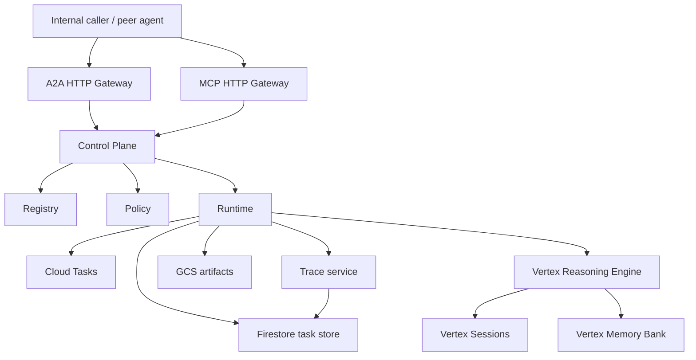

# AgentMesh

`AgentMesh` is the internal multi-agent control plane for this codebase.

It is intentionally isolated from the existing `agent_jobs`, `scout`, `scopeagent`, and `watchruntime` modules. In v1 it provides:

- mesh-level agent registry and capability routing
- signed A2A-facing agent cards
- MCP-facing tool gateway with governance
- durable task lifecycle on Firestore + Cloud Tasks
- Vertex AI Reasoning Engine, Sessions, and Memory Bank integration
- artifact persistence in GCS
- trace lineage and cost attribution snapshots
- policy and approval gates

It does **not** replace Vertex Agent Builder or Reasoning Engine. Vertex remains the managed execution substrate. AgentMesh adds orchestration, routing, policy, lifecycle, and observability on top.

## Boundaries

| Concern | Owned by Vertex | Owned by AgentMesh |
| --- | --- | --- |
| Model execution | Yes | No |
| Session runtime | Yes | No |
| Long-term memory substrate | Yes | No |
| Mesh routing | No | Yes |
| Capability registry | No | Yes |
| Task leases and retries | No | Yes |
| Approval workflow | No | Yes |
| Artifact exchange | Partially | Yes |
| Budget enforcement | Partially | Yes |
| Cross-agent lineage | Partially | Yes |

## Package Layout

- [`contracts`](./contracts/README.md): canonical type system
- [`registry`](./registry/README.md): system agents, agent cards, signing, verification
- [`controlplane`](./controlplane/README.md): routing and orchestration decisions
- [`policy`](./policy/README.md): invocation, model, tool, and trust-zone guards
- [`repo`](./repo/README.md): Firestore and GCS persistence
- [`runtime`](./runtime/README.md): execution lifecycle, review gates, retries, budgets
- [`tasks`](./tasks/README.md): Cloud Tasks dispatch
- [`trace`](./trace/README.md): task spans and lineage snapshots
- [`transport`](./transport/README.md): external protocol surfaces
- [`vertex`](./vertex/README.md): Vertex substrate adapters

## Runtime Architecture

## Core Lifecycle

1. Caller submits a task over A2A or invokes a governed MCP tool.
2. AgentMesh validates the signed agent card and request policy.
3. Control plane routes the task to a mesh agent.
4. Runtime persists the task in Firestore and enqueues execution with Cloud Tasks.
5. Worker claims the task with a transactional Firestore lease.
6. Runtime ensures a Vertex Session and binds the task to a Vertex Reasoning Engine.
7. Worker executes via Vertex-hosted Gemini.
8. Output is stored as a typed artifact in GCS.
9. Reviewer executes a second Vertex pass.
10. If human approval is required, the task moves to `awaiting_review`.
11. Final status, lineage, usage, artifacts, and approval metadata are persisted.

## Control-Plane Data Model

Firestore collections:

- `agentmesh_agents`
- `agentmesh_capabilities`
- `agentmesh_tasks`
- `agentmesh_artifacts`
- `agentmesh_traces`
- `agentmesh_policies`
- `agentmesh_runtime_locks`

Artifact bucket:

- `gs://$PROJECT_ID-agentmesh-artifacts`

Queue:

- `etigram-agentmesh`

Cloud Run service:

- `etigram-agentmesh`

## Built-In Mesh Agents

- `mesh.supervisor`: routing, planning, control-plane orchestration
- `mesh.worker`: execution against Vertex
- `mesh.reviewer`: final verification before success

## Protocol Surface

- A2A version: `1.0.0`
- A2A binding in v1: internal HTTP+JSON gateway
- MCP transport in v1: remote HTTP JSON-RPC gateway

The current implementation is production-oriented for internal use, but it is still narrower than the full public protocol surface of the A2A and MCP specifications.

## Security Model

- signed agent cards are mandatory for A2A and MCP callers
- signing is KMS-backed asymmetric signing in production
- runtime invocations are IAM-protected Cloud Run calls
- task execution uses Firestore transactional leases
- tool and model usage is enforced per agent policy
- review-required tasks must be explicitly approved or rejected

## Operational Notes

- AgentMesh assumes a pre-created Vertex Reasoning Engine resource and validates it at startup.
- Deploy is handled by [`/Users/kirisyuk/cursor/sanskrite/scripts/deploy`](/Users/kirisyuk/cursor/sanskrite/scripts/deploy) with `--agentmesh`.
- The deploy flow ensures KMS, Firestore indexes, Cloud Tasks, bucket, service account, and Cloud Run.

## Related Entry Points

- runtime binary: [`../../cmd/agentmesh/README.md`](../../cmd/agentmesh/README.md)
- deploy script: [`/Users/kirisyuk/cursor/sanskrite/scripts/deploy`](/Users/kirisyuk/cursor/sanskrite/scripts/deploy)

## External References

- [Vertex AI Reasoning Engine](https://cloud.google.com/vertex-ai/generative-ai/docs/agent-engine/overview)
- [Vertex AI Agent Builder overview](https://cloud.google.com/products/agent-builder)
- [A2A specification](https://a2a-protocol.org/v1.0.0/specification/)
- [Model Context Protocol](https://modelcontextprotocol.io/specification/2024-11-05/architecture/index)
