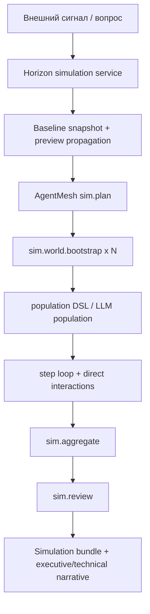

# AgentMesh Simulation Runtime Architecture

Этот документ фиксирует текущее состояние многоагентного симуляционного runtime поверх `AgentMesh + Horizon graph`.

Он описывает не исследовательскую идею, а текущую инженерную реализацию:

- как симуляция встраивается в AgentMesh;
- как описываются агенты;
- какие требования предъявляются к агентному описанию;
- как должен быть описан граф мира;
- какие требования предъявляются к graph bindings, чтобы агенты могли по нему осмысленно играть.

## Назначение

Слой симуляции нужен для обработки внешнего сигнала или вопроса как `ensemble of worlds`, а не как одиночный prompt-response.

`Horizon` даёт:

- канонический граф мира;
- фрагменты, связи, механизмы, программы, рынки, институты;
- baseline snapshot;
- propagation preview и structural grounding.

`AgentMesh` даёт:

- оркестрацию миров;
- runtime задач и capability routing;
- population generation;
- world-step execution;
- агрегацию bundle;
- review и trace persistence;
- системный discipline/function/role interpretation layer, синтезированный из actor traces и graph bindings.

## Высокоуровневая схема

## Runtime capabilities

Текущие capability families:

- `sim.plan`
- `sim.world.bootstrap`
- `sim.population.generate`
- `sim.world.step`
- `sim.aggregate`
- `sim.review`

Физически это выполняется внутри `AgentMesh` runtime, а не отдельным сервисом симуляции.

## Модель мира

Текущий runtime — гибридный.

Что детерминировано:

- baseline scope;
- baseline snapshot digest;
- world bootstrap;
- action normalization;
- metric update rules;
- aggregate summary;
- review.

Что может быть генеративным:

- population generation;
- step action generation.

Если `Vertex` доступен, population/actions могут прийти из LLM, но всегда нормализуются к жёсткому контракту.

Если `Vertex` недоступен или сценарий требует curated control, используется scenario DSL / fallback policy.

## Как описываются агенты

Канонический runtime-type: [`SimulationAgentSpec`](/Users/kirisyuk/cursor/sanskrite/backend/internal/horizon/models/simulation.go)

Обязательные поля:

- `agentClass`
- `displayName`
- `populationWeight`
- `allowedActions`
- `worldId`
- `runId`
- `tenantId`

Ключевые смысловые поля:

- `originKind`
- `originRefs`
- `traits`
- `beliefState`
- `resourceState`
- `messageStyle`
- `policyHints`
- `justification`
- `generatedBy`
- `schemaVersion`

### Семантика полей

`agentClass`

- класс поведения, а не красивое имя;
- должен быть стабилен между сценариями;
- используется в activation rules, interaction rules, scoring и narrative synthesis.

`originRefs`

- канонические path-refs на узлы Horizon graph;
- это главный способ привязать агента к миру;
- агент без `originRefs` допустим только как временный synthetic fallback, но считается слабее grounded.

`traits`

- медленные свойства поведения;
- примеры: `attention`, `riskBias`, `variant`.

`beliefState`

- текущие убеждения/напряжение;
- минимально: `trust`, `stress`.

`resourceState`

- операционные ограничения;
- минимально: `budget`;
- дальше могут добавляться `liquidity`, `inventory`, `capacity`, `taxCredit`, `procurementSlack`.

`allowedActions`

- строгое ограничение допустимых действий;
- runtime не должен позволять агенту выйти за этот список.

## JSON DSL агентов

Текущее scenario-specific описание уже вынесено в JSON DSL, пример: [`kzvat.json`](/Users/kirisyuk/cursor/sanskrite/backend/internal/agentmesh/simulation/scenarios/kzvat.json)

DSL сейчас поддерживает:

- `population[]`
- `directInteractions[]`

### Population template

Каждый population item задаёт archetype-шаблон:

- `agentClass`
- `displayNamePattern`
- `count`
- `populationWeightBase`
- `populationWeightStep`
- `originRefs`
- `allowedActions`
- `traits`
- `traitsStep`
- `beliefState`
- `beliefStateStep`
- `resourceState`
- `resourceStateStep`
- `messageStyle`
- `policyHints`

Это означает:

- один JSON item может породить несколько однотипных агентов;
- агенты в одном классе могут немного отличаться весом и параметрами;
- variation должна быть управляемой и объяснимой, а не случайной без следа.

### Требования к описанию агента в DSL

Минимальные требования:

- класс должен быть осмысленным и повторно используемым;
- `originRefs` должны указывать на канонические path-ы ядра;
- `allowedActions` должны быть подмножеством runtime vocabulary;
- `traits/belief/resource` должны быть нормализованы в диапазонах, пригодных для scoring.

Желательные требования:

- `messageStyle` описывает тип публичной реакции;
- `policyHints` содержит роль, сегмент или institutional function;
- `displayNamePattern` должен быть читаемым человеком.

Нежелательно:

- описывать агента только через естественный язык без структурных полей;
- использовать ad hoc path labels вне канонического графа;
- дублировать один и тот же класс под разными именами без необходимости.

## Direct interactions

Новый слой прямых межагентных взаимодействий описывается в DSL через `directInteractions[]`.

Каждое правило включает:

- `id`
- `axes`
- `sourceClasses`
- `actionTypes`
- `minStep/maxStep`
- `variantMin/variantMax`
- `targetSelectors`
- `limit`
- `effects`

### Что делает interaction rule

Правило читается так:

`если агент класса X на оси A сделал действие Y, то на шаге S воздействуй на целевых агентов T эффектом E`

Текущие эффекты:

- `stressDelta`
- `trustDelta`
- `budgetDelta`
- `attentionDelta`

Это не заменяет общий state мира, а усиливает его адресным влиянием.

### Target selectors

Сейчас поддерживаются селекторы:

- `class:<agentClass>`
- `domain:<domain>`
- `origin:<canonicalPath>`
- `agent:<agentId>`

Это даёт управляемый переход к более сложным микровзаимодействиям.

## Action vocabulary

Текущий строгий словарь действий:

- `broadcast_message`
- `change_belief`
- `buy`
- `sell`
- `delay_purchase`
- `switch_supplier`
- `reserve_inventory`
- `reroute_shipment`
- `expedite_shipment`
- `allocate_capacity`
- `reprioritize_flow`
- `request_exemption`
- `hedge_cost`
- `adjust_guidance`
- `lobby`
- `issue_statement`
- `enforce_rule`
- `adjust_budget`
- `escalate`
- `do_nothing`

## Discipline-First Interpretation Contract

Runtime теперь обязан собирать не только `executiveNarrative`, но и структурированный discipline-first результат внутри `SimulationBundle`.

Primary contracts:

- `DisciplinedSignals`
- `FunctionExposures`
- `DecisionDemands`
- `MonitoringSignals`
- `RoleReadouts`

`ExecutiveMemo` остаётся только как backward-compatible projection поверх этих контрактов.

### Primary semantics

- `DisciplinedSignals`
  Какие дисциплины активировались сигналом: policy, operations, finance, reputation, demand и т.д.

- `FunctionExposures`
  Какие функции системы/организации реально под давлением: finance, operations, procurement, regulatory, communications, product.

- `DecisionDemands`
  Какие типы решений swarm фактически требует от управляющего контура.

- `MonitoringSignals`
  Что и зачем нужно смотреть с заданной cadence.

- `RoleReadouts`
  Производные представления для ролей (`CFO`, `COO`, `PR Lead` и т.д.), строящиеся поверх первых четырёх слоёв.

### Принцип построения memo

Ни `ExecutiveMemo`, ни `RoleReadouts` не должны быть свободным текстом “после факта”.

Они должны опираться на:

- `OutcomeDistribution`
- `Sensitivity`
- `ActorReactions`
- `MechanismChains`
- `GraphValidation`
- `ActionProfile`
- `DisciplinedSignals`
- `FunctionExposures`
- `DecisionDemands`
- `MonitoringSignals`

Иными словами:

- swarm сначала играет мир;
- aggregate synthesizer строит actor/method traces;
- discipline layer собирает role-neutral смысл;
- только после этого role adapters строят представления для конкретных функций.

### Требование нерегрессии

Любой новый scenario overlay должен:

- сохранять общий discipline-first contract;
- добавлять scenario-specific смысл поверх generic layer, а не заменять её полностью;
- уметь строить role readouts из function exposures, а не напрямую из prompt;
- не смешивать ядро интерпретации с presentation для одной конкретной роли.

Требования:

- любое новое действие должно пройти через типизацию и validator;
- любое действие должно иметь интерпретируемый state effect;
- action type не должен быть произвольным текстом.

## Как должен быть описан граф мира

Для такого runtime граф должен быть описан не “тематически”, а операционно.

Нужно, чтобы в графе были:

- `решение` или `сигнал`
- `механизм воздействия`
- `программа / policy wrapper`
- `институты / органы`
- `затрагиваемые рынки`
- `сообщества / группы`
- `география`
- `вторичные эффекты`

Для policy-шока минимальная цепочка должна выглядеть так:

`decision -> mechanism -> program -> markets/institutions/communities -> secondary effects`

### Требования к graph nodes

Узлы должны быть:

- канонически адресуемыми;
- типизированными;
- пригодными для `originRefs`;
- пригодными для propagation.

Для симуляции особенно важны узлы следующих типов:

- `/decision/...`
- `/mechanism/...`
- `/program/...`
- `/gov/...`
- `/market/...`
- `/community/...`
- `/loc/...`

### Требования к graph edges

Нужны не просто связи, а причинно-полезные связи.

Особенно полезны:

- `USES_MECHANISM`
- `ADMINISTERS`
- `GATEKEEPS_DECISION`
- `REGULATES`
- `IMPOSES_CONDITION`
- `APPLIES_TO`
- `INFLUENCES`
- `PARTICIPATES_IN`
- `OPERATES_IN`

Требование:

- граф должен позволять построить объяснимую causal chain от сигнала до affected layers.

Если граф не содержит вторичных эффектов, симуляция будет давать плоскую реакцию.

## Требования к graph bindings для агентов

Агент считается хорошо grounded, если:

- имеет `originRefs` на реальные canonical nodes;
- его класс согласуется с типом узла;
- его действия направлены на узлы или контуры, существующие в графе;
- по его `originRefs` можно объяснить, почему именно он участвует в сценарии.

Примеры хорошего binding:

- `budget_revenue_officer -> /market/kz/public-sector/budget-revenue`
- `healthcare_public_operator -> /market/kz/healthcare/healthcare-public + /market/kz/public-sector/budget-revenue`
- `investment_climate_officer -> /market/kz/finance/investment-climate`

Плохой binding:

- агент класса `state` без конкретного `originRef`;
- agent role, противоречащая типу привязанного узла;
- agent targets, не существующие в графе.

## Минимальные требования к сценарию

Чтобы сценарий был пригоден для AgentMesh simulation runtime, должны быть выполнены условия:

1. Есть baseline scope, из которого можно собрать snapshot.
2. Есть seed paths, дающие старт propagation.
3. Есть хотя бы одна причинная цепочка от решения к affected domains.
4. Есть хотя бы один population layer, привязанный к реальным graph nodes.
5. Есть хотя бы один набор axis-specific activation rules.
6. Есть action vocabulary, достаточный для домена.

## Что уже работает хорошо

- ensemble execution поверх AgentMesh;
- reusable JSON DSL для scenario population;
- direct interaction rules между агентами;
- graph-grounded population;
- actor reactions и mechanism chains;
- executive + technical narrative synthesis из traces.

## Подготовка фактуры из линзы

Текущий вход в симуляцию начинается не с агентов, а с `lens-aware fact preparation`.

### Технически

`Horizon simulation service` делает следующее:

1. Берёт `lensId`, `question`, `signal`, `mode`, `seedPaths`.
2. Собирает baseline scope из:
   - `lens.Scope`
   - `viewConfig`-paths
   - связанных fragment paths
   - artifact refs
   - canonical scope paths
3. Строит `Recognition`:
   - `axisCandidates`
   - `objectCandidates`
   - `volumeProfile`
   - `primaryAxis`
   - `summary`
4. Строит `BaselineSignal`:
   - `axis`
   - `actorPaths`
   - `locationPath`
   - `seedPaths`
   - `magnitude`
5. Запускает preview propagation и сохраняет `BaselinePreview`.

Кодовые точки:

- [`/Users/kirisyuk/cursor/sanskrite/backend/internal/horizon/simulation/service.go`](/Users/kirisyuk/cursor/sanskrite/backend/internal/horizon/simulation/service.go)
- [`/Users/kirisyuk/cursor/sanskrite/backend/internal/horizon/simulation/recognition.go`](/Users/kirisyuk/cursor/sanskrite/backend/internal/horizon/simulation/recognition.go)

### Человечески

Система сначала не “играет мир”, а отвечает себе на три вопроса:

- что это за шок;
- где именно в мире он сидит;
- насколько это локальный объект, цепочка или целая сеть.

Только после этого имеет смысл поднимать swarm агентов.

## Контракт распознавания

`Recognition` — это первый обязательный structured output.

### Обязательные поля

- `primaryAxis`
- `axisCandidates[]`
- `objectCandidates[]`
- `volumeProfile`
- `summary`

### Минимальная семантика

`primaryAxis`

- главная рабочая ось мира: `physical_flow`, `logistics`, `financial`, `legal/compliance`, `info/reputation`.

`objectCandidates`

- канонические path-узлы, на которых должен строиться мир;
- score ниже рабочего порога не должен участвовать в scenario matching.

`volumeProfile`

- `focused_object`
- `single_chain`
- `sector_network`
- `cross_border_network`

### Требование к качеству

Распознавание считается хорошим, если:

- primary axis объясним из query + scope;
- top objects действительно совпадают с линзой;
- volume profile не раздувает локальный мир в глобальную сеть без причин.

## Контракт baseline signal

`BaselineSignal` — это bridge между распознаванием и миром.

### Технически

Он собирается не как raw prompt, а как нормализованный shock-object:

- `axis`
- `actorPaths`
- `locationPath`
- `seedPaths`
- `magnitude`
- `polarity`

### Человечески

Это уже не “вопрос пользователя”, а “с чем мир должен иметь дело”.

## Как работают и взаимодействуют агенты

### Технически

Агент в runtime существует в четырёх слоях одновременно:

1. `Identity layer`
   - `agentClass`
   - `displayName`
   - `originRefs`
   - `allowedActions`
2. `State layer`
   - `beliefState`
   - `resourceState`
   - `traits`
3. `Interaction layer`
   - inbox/outbox
   - direct interaction rules
   - protocol messages
4. `Execution layer`
   - actions
   - transactions
   - review queue
   - relationship memory

### Человечески

Агент теперь не просто “реагирует на мир”.
Он:

- получает сообщение,
- интерпретирует его в рамках своей роли,
- может отправить ответ,
- может поставить объект в review,
- может протолкнуть или задержать сделку,
- и при этом помнит, как этот контрагент вёл себя раньше.

## Протоколы и транзакции

### Текущие протоколы

- `regulatory_case`
- `routing_protocol`
- `allocation_protocol`
- `settlement_protocol`
- `procurement_protocol`
- `narrative_protocol`
- `coordination_protocol`

### Текущие transaction types

- `license_case`
- `shipment_reroute`
- `inventory_reservation`
- `capacity_allocation`
- `settlement_cover`
- `supplier_switch`
- `procurement_order`

### Queue semantics

Текущий мир уже различает:

- `review_pending`
- `under_review`
- `awaiting_response`
- `responded`
- `reviewed`
- `direct`
- `closed`

### Status semantics

Текущие статусы исполнения:

- `proposed`
- `pending_review`
- `approved`
- `in_execution`
- `delayed`
- `fulfilled`
- `reserved`
- `rerouted`
- `cleared`
- `rejected`
- `blocked`

### Человечески

Это означает, что мир теперь умеет показать не только “где стресс”, а:

- где запрос ушёл на review;
- где его приняли;
- где его задержали;
- где поток реально перенаправили;
- где мощность распределили, но не довели до исполнения.

## Сигналы, которые подают агенты

В мире есть три класса сигналов.

### 1. Action signals

Это непосредственно нормализованные действия:

- `request_exemption`
- `reroute_shipment`
- `reserve_inventory`
- `allocate_capacity`
- `adjust_budget`
- `adjust_guidance`

Именно они двигают состояние мира.

### 2. Protocol signals

Это сообщения и ответы:

- request
- review
- accept
- reject
- delay
- counter
- align

Они двигают очереди, review-loop и relationship memory.

### 3. Transaction signals

Это изменения статуса execution objects:

- order moved to `approved`
- reroute became `rerouted`
- allocation stays `in_execution`
- case became `blocked`

Именно этот слой делает симуляцию операционной.

## Контракт интерпретации LLM-сигналов

LLM в runtime не является источником истины. Он может выдавать только `proposal signals`.

### Разрешённые LLM outputs

1. `population proposal`
   - future agents, but only in `SimulationAgentSpec` schema
2. `action proposal`
   - only from strict action vocabulary
3. `review proposal`
   - structured rationale / issues / accepted flag

### Что считается валидным

LLM output должен пройти:

- action type validation
- target presence validation
- allowedActions check
- delta cap
- graph grounding check
- scenario isolation check

### Как интерпретировать LLM output

Правильный контракт:

- LLM не говорит, “что правда”
- LLM предлагает, “что этот агент или reviewer мог бы сделать”
- runtime решает, проходит ли это через физику, граф и policy

### Что нельзя делать

- нельзя считать LLM text final answer мира;
- нельзя брать unstructured prose как action;
- нельзя давать LLM право напрямую писать в graph или world state без validator.

## Как интерпретируются результаты

Первичный результат должен оставаться role-neutral.

### Core layers

- `OutcomeDistribution`
- `ActionProfile`
- `ProtocolSummary`
- `TransactionSummary`
- `DisciplinedSignals`
- `FunctionExposures`
- `DecisionDemands`
- `MonitoringSignals`

### Человечески

Это означает, что система сначала отвечает:

- какие силы реально активировались;
- какие функции под ударом;
- какие решения demanded;
- что наблюдать.

А уже потом строит readout под конкретную роль.

## Представление результатов для дисциплинарных C-level ролей

`RoleReadouts` — это adapters, а не отдельная логика мира.

### Принцип

Один и тот же run должен уметь быть прочитан разными ролями без переписывания swarm-а.

### CFO

Смотрит на:

- `treasury_finance`
- cost of resilience
- settlement/review loops
- guidance shift

Выход:

- где схема становится дорогой;
- где страхование, оплата, покрытие и margin protection становятся bottleneck.

### COO

Смотрит на:

- `supply_operations`
- `product_program`
- routing / allocation / reservation loops

Выход:

- где поток реально тормозится;
- где capacity allocation уже стал ручным;
- что надо защищать первым.

### Compliance Lead

Смотрит на:

- `trade_compliance`
- review queues
- screening / exemption / license loops

Выход:

- где compliance стал частью execution path, а не пост-фактум контролем.

### PR Lead / IR

Смотрит на:

- `investor_reputation`
- `communications`
- divergence между operating reality и narrative layer

Выход:

- где внешняя линия рискует убежать вперёд реальности.

### General rule

Ни одна роль не должна получать “отдельный мир”.
Все роли читают один и тот же run через разные projections.

## Как определять фазы развития реакции системы

Фазы нужны не как красивая метафора, а как operational state machine над traces и metrics.

### Рекомендуемые фазы

1. `recognition`
   - сигнал распознан
   - scope и baseline собраны

2. `activation`
   - агенты начали действия
   - protocol volume растёт
   - review queue ещё мала

3. `screening_and_review`
   - review queues и approval loops становятся заметны
   - compliance / state / treasury начинают gatekeeping

4. `execution_reshaping`
   - доминируют `reroute`, `reserve`, `allocate`, `reprioritize`
   - transactions moving to `approved/in_execution/rerouted/reserved`

5. `commercial_spillover`
   - появляются delay/cost/guidance/customer slippage effects

6. `stabilization_or_degradation`
   - мир либо стабилизируется через новые execution loops,
   - либо накапливает delays/blocked/rejected paths

### Технические правила определения

Фазы должны выводиться из:

- `ProtocolSummary`
- `TransactionSummary`
- `MonitoringSignals`
- open review queue
- open transactions
- dominant actions
- variance between worlds

### Человечески

Это позволяет отвечать не только “что случилось”, но и “на какой стадии реакции сейчас находится система”.

## Что пока не завершено

- полноценный ledger-level accounting для денег, дебиторки и обязательств;
- inventory/capacity engine с реальными единицами объёма;
- richer counterparty negotiation protocols с многократными round-trip;
- отдельный versioned schema contract для scenario DSL;
- high-fidelity calibration against real sector and macro data.

## Практический вывод

Текущий simulation runtime уже нужно проектировать не как “набор промптов”, а как три согласованных слоя:

- `Horizon graph` как структурированная модель мира;
- `Agent DSL` как portable описание репрезентаторов этого мира;
- `AgentMesh runtime` как оркестратор миров, действий, взаимодействий и агрегации.

Если любой из этих слоёв слабый, симуляция быстро теряет объяснимость.

После текущего цикла это уже можно формулировать сильнее:

- `Horizon` готовит фактуру;
- `Recognition` нормализует вход;
- `AgentMesh` разворачивает дисциплинарно осмысленный мир;
- `protocol + transaction layer` превращают его в исполнимую микросреду;
- `discipline-first interpretation` превращает результат в управленчески читаемый output.
