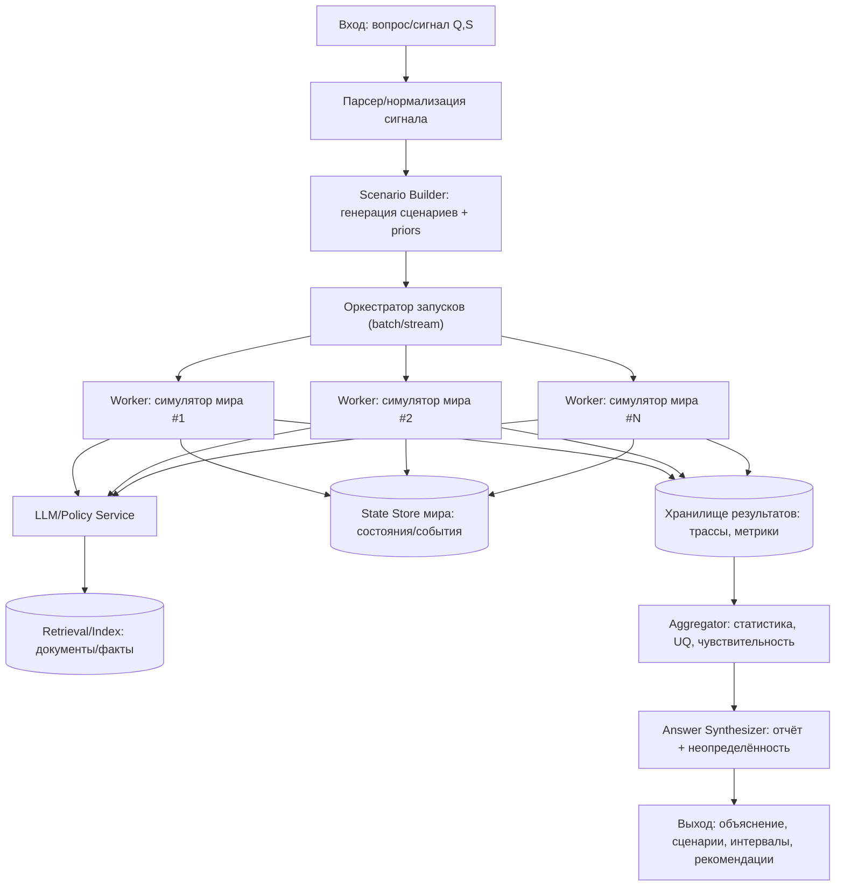

# Система многоагентных социально-экономических симуляторов, отвечающая на входной сигнал через массовое разыгрывание реакций

## Резюме для руководителя

Предмет исследования — архитектура и методы построения системы, которая получает на вход вопрос/сигнал (например, новость, изменение политики, ценовой шок, кризисное сообщение, запуск продукта) и автоматически запускает множество параллельных симуляторов социально-экономических агентов. Каждый симулятор разворачивает сценарий «в мире» (сеть взаимодействий, рынки, информационные каналы, институты, ограничения), а затем система агрегирует распределение исходов и формирует ответ: что вероятнее всего произойдёт, почему, при каких допущениях и с какой неопределённостью. Такой подход естественно опирается на агент-ориентированное моделирование (ABM/ACE), многоагентные системы (MAS), модели динамики мнений и на современную линию работ по «генеративным агентам» и LLM-агентам.

Ключевой вывод: практично реализуемая система почти неизбежно будет гибридной. Классические ABM-агенты обеспечивают контролируемость, скорость, интерпретируемость и калибровку под данные; LLM-агенты усиливают реалистичность текстовых реакций, аргументации и «социальной психологии», но порождают риски нестабильности, галлюцинаций, смещения и слабой воспроизводимости. Следовательно, «разумный центр тяжести» — это ABM как физика мира + LLM как модуль принятия решений/коммуникации под жёсткими ограничениями (с нормированием действий, проверкой фактов и ансамблированием).

Практические приоритеты «с первого дня»:

- стандартизовать спецификацию моделей и экспериментов (например, через ODD/ODD-подобный шаблон), чтобы обеспечивать повторяемость и аудит;
- строить систему как ансамбль сценариев + статистическая агрегация, а не как «один прогон»;
- заранее заложить строгую программу валидации: backtesting на исторических эпизодах, чувствительность/неопределённость, устойчивость к «адверсариальным» входам и краснокомандные проверки;
- архитектурно отделить «мир/симулятор» от «LLM-интерпретатора» и хранить полную трассу решений, семена случайности и версии данных/промптов для воспроизводимости.

Открытые исследовательские вопросы наиболее существенны в трёх зонах:

- верность LLM-симуляций людям/институтам и способы калибровки;
- оценка качества многоагентных LLM-систем (метрики и эталоны);
- управление рисками (privacy/security/манипуляции и соответствие регулированию).

## Постановка задачи и допущения

### Цель системы

По входному сигналу `S` и вопросу `Q` сформировать ответ `A`, который включает:

1. набор вероятных траекторий реакции общества/рынков/акторов;
2. объяснение механизмов (какие микро-правила и каналы связи порождают макро-паттерны);
3. неопределённость и чувствительность к допущениям;
4. сравнение вмешательств/политик (контрфакты).

Такой стиль «генеративного объяснения» соответствует позиции «вырастить явление» в искусственном обществе.

### Что такое «вопрос/сигнал»

В практических продуктах это обычно один из типов: новостное событие, текст кампании, изменение цены/ставки/налога, регуляторное объявление, шок предложения/спроса, репутационный инцидент, изменение доступности товара, сбой инфраструктуры, санкции/ограничения, запуск конкурента и т.п.

В этом документе предполагается, что домен не задан и может варьировать от маркетинга до макрополитики.

### Намеренно открытые параметры

- Масштаб: от десятков до миллионов агентов (реалистично — многоуровневое моделирование и агрегирование, иначе вычислительные затраты взрываются).
- Горизонт: от часов/дней (информационные волны) до месяцев/лет (институциональная адаптация).
- Данные: предполагается хотя бы частичный доступ к наблюдениям (временные ряды, опросы, транзакции, соцсети, макропоказатели) для калибровки и backtesting; если данных мало — применяется pattern-oriented подход и широкая неопределённость.
- Модуль LLM: считается заменяемым (закрытая модель через API или собственная). Приоритет — контролируемость, журналирование, защита данных и воспроизводимость.
- Артефакт ответа должен быть не только «текстом», но и структурированным объектом: распределения исходов, интервалы неопределённости, отчёты по чувствительности, список ключевых механизмов и контрмер. Это важно из-за риска «правдоподобной, но неверной» генерации в LLM-компонентах.

## Обзор литературы и опорные идеи

Литературу удобно разложить на пять линий, каждая из которых даёт «деталь» для целевой системы.

### Агент-ориентированное моделирование (ABM) и генеративное объяснение

Классические работы показывают, как из локальных правил (предпочтений соседства, ограниченной рациональности, адаптивного обучения) могут возникать макро-регулярности (например, сегрегация, рыночные паттерны). Это и есть основной смысл ABM как подхода.

### Агент-ориентированная вычислительная экономика (ACE)

В экономике ABM оформляется как ACE: экономика как эволюционирующая система взаимодействующих автономных агентов, где институты и сети могут быть эндогенны. Для рассматриваемой системы это означает:

- можно моделировать рынки и организации как агентные экосистемы;
- естественно запускать ансамбли сценариев как «виртуальные эксперименты».

### Многоагентные системы (MAS) и протоколы взаимодействия

MAS-литература даёт формальные инструменты: типы сред, координация, торги/аукционы, распределение задач, теоретико-игровые и логические основания. На практике это превращается в дизайн «протоколов» общения/торга между агентами и в инфраструктуру, родственную распределённым системам.

### Динамика мнений и социальная физика

Для входных сигналов, которые распространяются через коммуникацию (новость, слух, реклама, политическое сообщение), важны модели консенсуса/поляризации/фрагментации, bounded confidence, влияние сетевой структуры и «лидеров мнений». Это даёт компактные механизмы для макро-описания и удобные метрики для валидации.

### Генеративные агенты и LLM-социальные симуляции

Современная ветка (после 2022-2023) показывает, что LLM можно использовать как «мозг» агента: память, планы, самообъяснение, роль-персоны, диалоговое влияние, а также как инструмент генерации синтетических «выборок людей» для опросов/экспериментов. Одновременно появляется критика: LLM-симуляции могут быть непоследовательны, неустойчивы и в ряде случаев плохо совпадать с человеческим поведением — значит, их нельзя безоговорочно считать заменой эмпирики.

### Российский контекст

В русскоязычной практике агент-ориентированные модели активно применяются к социально-экономическим объектам (например, модели кластеров/территорий, производственных систем), что подтверждает наличие прикладного спроса и исходных источников данных/экспертиз.

### Лучшие практики описания моделей

Стандартизация описания ABM (ODD) важна, потому что без неё модели трудно воспроизводить и валидировать; современная версия ODD отдельно подчёркивает ясность, возможность репликации и «структурный реализм».

## Проектирование агентов и сценариев

Ниже — практический чек-лист дизайна, ориентированный именно на систему массовых симуляторов (ансамбль), а не на один «демо-мир».

## Дизайн агентов: типы, архитектуры, состояния и протоколы

### Ключевые источники

Для классических ABM/ACE-агентов — базовые ABM/ACE работы и обзоры инструментов; для когнитивных архитектур — BDI; для протоколов взаимодействия — спецификации сообщений и MAS-фреймворки; для стандарта описания — ODD.

### Лучшие практики

- Разделяйте внутреннее состояние и наблюдения. Агент не должен иметь магический доступ к глобальной истине; наблюдения должны быть ограничены сетью, медиа-каналами и задержками. Это критично для реалистичных реакций на сигнал и для предотвращения «идеальной координации».
- Явно задавайте пространства состояний и действий. Даже если LLM генерирует текст, исполнение должно сводиться к конечному набору действий (`купить`, `продать`, `поделиться`, `игнорировать`, `изменить мнение на Δ`, `переключить канал` и т.п.) — иначе симуляция становится неуправляемой и невоспроизводимой.
- Гетерогенность по умолчанию. Минимально: распределения по ресурсам, предпочтениям, доверчивости, сетевому положению и вниманию. Без гетерогенности часто невозможно получить правдоподобные макро-паттерны.
- Многоуровневые агенты. Для социально-экономических систем часто нужны агенты-индивиды и агенты-организации/институты одновременно; иначе придётся «зашивать институты» в правила среды, теряя контрфакты.
- Протоколы взаимодействия как отдельный слой. Для сделок/распределения задач/переговоров используйте формальные протоколы (аукционы/contract-net-подобные схемы) вместо «свободного чата», чтобы обеспечить воспроизводимость и измеримость.
- Стабильность поведения LLM-агентов через ограничения. LLM хорошо подходит для генерации аргументации и интерпретации, но не должен напрямую изменять критические переменные без проверок (например, не менять цену на `10x` без лимитов). Это снижает риск «галлюцинаторных» действий и дрейфа.

### Компромиссы

Интерпретируемость ↔ реалистичность: жёсткие правила и эконометрические решения легче анализировать и калибровать, но хуже воспроизводят нарративные реакции; LLM-агенты наоборот.

Скорость ↔ богатство поведения: подробная когниция и текстовый диалог дороги вычислительно и могут снижать масштаб.

Воспроизводимость ↔ адаптивность: обучение и сложные промптинговые схемы повышают адаптивность, но усложняют повторяемость.

### Открытые вопросы

- Как стандартизовать «когнитивные параметры» LLM-агентов так же, как параметры ABM?
- Как измерять «социальную правдоподобность» на уровне микропереходов (изменения мнений/доверия), а не только текстовой правдоподобности?
- Как предотвратить модовый коллапс поведения, когда многие агенты начинают говорить/действовать одинаково из-за общей модели?

### Шаги реализации

1. Выбрать базовый набор типов агентов (индивиды, фирмы, регулятор, медиа/платформы, банки/посредники).
2. Описать модель по шаблону, совместимому с ODD: сущности, переменные состояния, шкалы, процессы, дизайн-концепции, детали.
3. Ввести контракт действий: список допустимых операций, ограничения, штрафы/стоимости, проверка инвариантов.
4. Задать протоколы коммуникации/торга (минимум: широковещание + личные связи; для экономики: торги/контракты).

## Дизайн сценариев: сигнал, среда, горизонты, стохастика, интервенции

### Ключевые источники

Практика ABM-экспериментов, sensitivity analysis и неопределённость (включая вариации Монте-Карло), методы калибровки/коррекции и стандарты описания экспериментов.

### Лучшие практики

- Сценарий = сигнал + контекст. Один и тот же текст/шок ведёт к разным исходам при разных сетях, доверии к источникам, ликвидности/доходах и институциональных правилах. Поэтому сценарий должен включать контекстные параметры и начальные условия, а не только сам сигнал.
- Ансамбль вместо единственного прогона. Для стохастических моделей нужно много прогонов с разными семенами и параметрами; итог — распределение выходов, а не точка.
- Явные интервенции вместо «магии». Контрмеры (регулирование, модерация, субсидии, таргетированная коммуникация) должны быть формализованы как изменения правил или параметров; иначе результат не сравним.
- Горизонт и шаг времени как часть модели. Ошибка масштаба (слишком крупный шаг) может маскировать или создавать колебания/каскады. Это следует фиксировать в спецификации эксперимента.

### Компромиссы

Длинный горизонт полезен для анализа адаптации, но резко увеличивает ветвление событий; короткий горизонт проще валидировать на данных, но даёт риск игнорировать вторичные эффекты.

Сильная стохастика повышает реализм, но расширяет доверительные интервалы и усложняет объяснения.

### Открытые вопросы

- Как автоматически генерировать «разумные» сценарии-контрфакты без утечки предвзятостей LLM?
- Как задавать вероятностные веса сценариев (`prior`) так, чтобы они были интерпретируемы и поддавались аудиту?

### Шаги реализации

1. Определить словарь сигналов (тип, источник, тональность, канал, целевые аудитории).
2. Создать `Scenario DSL`: машинно-читаемое описание мира, сигналов, интервенций, горизонта, семян, метрик.
3. Настроить генератор ансамбля: сетки параметров + латинский гиперкуб/квази-Монте-Карло для покрытия пространства.

## Сравнение вариантов дизайна агентов

| Вариант агента | Сильные стороны | Слабые стороны/риски | Когда выбирать |
| --- | --- | --- | --- |
| Правило-основанный (`FSM`/`if-then`), реактивный | Максимальная скорость, контроль, воспроизводимость; удобно для больших популяций | Часто слабая реалистичность и «жёсткость» поведения | Масштабные прогоны, стресс-тесты, быстрые контрфакты |
| Микроэкономический (полезность, дискретный выбор, бюджет/ограничения) | Хорошая связь с экономическими интерпретациями и данными; легче калибровать по агрегатам | Редуцирует психологию/нарратив; сложен для коммуникационных эффектов | Рыночные реакции, цены, спрос/предложение |
| BDI-архитектура (убеждения-цели-намерения) | Естественна для планирования и объяснимых решений; хорошо сочетается с протоколами | Требует тщательного проектирования убеждений/планов; может быть трудоёмкой | Моделирование организаций/акторов с целями и процедурами |
| Многоагентное обучение (`MARL`/обучающие агенты) | Может выучивать стратегии в среде; полезно для «оптимизирующих» акторов | Дорого, риск неустойчивости и переобучения; хуже интерпретируемость | Когда есть симулятор-тренажёр и нужен поиск стратегий |
| LLM-агент (роль/персона + диалог/обоснование) | Богатые текстовые реакции, аргументация, социальные эвристики | Галлюцинации, дрейф, непоследовательность, высокая стоимость | Текстовые сигналы, медиа-реакции, переговоры, «социальный слой» |
| Гибрид ABM+LLM (LLM как «мозг», ABM как «мир») | Баланс: контроль мира + реалистичность коммуникации | Сложнее инженерно; требуется дисциплина в ограничениях действий | Практический путь для производственных систем |

## Алгоритмы и ML/NLP/LLM-компоненты

Целевая система обычно включает три «интеллектуальных» уровня:

1. интерпретация входного сигнала;
2. генерация и выполнение действий агентами;
3. агрегация результатов в ответ.

## Промптинг, few-shot, рассуждение и роль-игра

### Ключевые источники

Few-shot/in-context обучение; chain-of-thought и self-consistency как ансамбль рассуждений; ReAct как соединение рассуждения и действий; роль-игра и многоагентные чаты (AutoGen/CAMEL); генеративные агенты как шаблон памяти/планов.

### Лучшие практики

- Делайте рассуждение опциональным и измеримым. Современные техники показывают пользу пошагового рассуждения и его ансамблирования (`self-consistency`), но в симуляции важно, чтобы рассуждение не превращалось в «неограниченный текст», который ломает воспроизводимость. Практика: фиксировать шаблоны и ограничивать длину, использовать `n-sample + majority/consistency`.
- `ReAct`-паттерн для «агент → инструмент → мир». Для агентов, которые должны опрашивать среду/поиск/таблицы/регистры, полезен шаблон «рассуждение + действие», где действие — вызов инструмента, а наблюдение возвращается в контекст. Это снижает чисто «галлюцинаторную» генерацию и делает траектории аудируемыми.
- Роль-игра — только в связке с ограничениями. Многоагентные роль-подсказки усиливают разнообразие поведения, но повышают риск стереотипизации/смещений. Нужно ограничивать роль фактическими атрибутами (демография/ресурсы/позиция в сети), логировать и валидировать распределения ответов.
- Память и «состояние личности» должны быть структурированы. В генеративных агентах показана архитектура с краткосрочной/долгосрочной памятью, извлечением релевантных воспоминаний и планированием. В производственной симуляции полезно хранить память как структурированные события + эмбеддинги + правила забывания/снижения веса.

## Retrieval, grounding и борьба с галлюцинациями

### Ключевые источники

Retrieval-Augmented Generation (RAG) как связка параметрической и непараметрической памяти; обзоры LLM-ABM подчёркивают проблемы grounding и оценки.

### Лучшие практики

- Разделить знания на: мир симуляции и внешние факты. Внешние факты (законы, справочники, цены, статистика) должны приходить через retrieval/БД, а не «из головы» модели. Внутренние факты мира — только из состояния симуляции.
- Grounding-контракты. Каждый факт-критичный фрагмент ответа агента должен ссылаться на источник (документ/таблица/переменная мира), иначе действие блокируется или помечается как неподтверждённое. Это превращает неопределённость в измеримую величину.

## Fine-tuning, SFT/RLHF и специализированные модели

### Ключевые источники

RLHF как способ подгонки под намерения человека; современные бенчмарки агентности; данные для tool-use.

### Рекомендации

- Если домен стабилен и высокие требования к предсказуемости — рассмотреть `SFT` на траекториях действий в симуляции + строгая оценка (иначе риск «натаскивания» без реальной валидности).
- `RLHF` полезен для следования инструкциям и снижения токсичности, но не заменяет калибровку под популяцию; для симуляций важнее корректность поведения, чем «полезность диалога».

## Сравнение ML-подходов для «мозга» агента

| Подход | Что даёт | Цена/риски | Практический паттерн внедрения |
| --- | --- | --- | --- |
| Few-shot/in-context | Быстрый старт без обучения | Чувствителен к формулировкам, нестабилен | Библиотека промптов + A/B-тесты на синтетических эпизодах |
| Chain-of-thought | Улучшает сложные рассуждения | Может быть многословным; труднее воспроизводить | Ограничение длины + шаблоны рассуждения |
| Self-consistency | Ансамбль траекторий рассуждения улучшает точность | Дороже по токенам/времени | `k` сэмплов + выбор наиболее согласованного действия |
| ReAct | Связка «думать → действовать → наблюдать»; лучше для интерактивных сред | Требует дисциплины инструментов и логирования | Tool API + трассировка действий; запреты на неавторизованные вызовы |
| RAG/grounding | Снижает галлюцинации на фактах, даёт ссылки на источники | Нужны индексы, качество retrieval критично | Белые списки корпусов + цитирование источников + кеширование |
| SFT/RLHF | Стабилизирует стиль/следование инструкциям | Риск переобучения и доменного дрейфа | Тренировать на логах симуляции + строгий hold-out по эпизодам |
| Tool-use datasets | Улучшает корректность вызовов инструментов | Возможны уязвимости «инструментальных» действий | Валидация схем API + sandbox + тесты на инъекции |

## Архитектура системы: масштабирование, оркестрация, данные, воспроизводимость

## Референс-архитектура (логическая)

Ниже — типовая архитектура `signal → ансамбль миров → агрегация → ответ`. Она ориентирована на:

- параллельность;
- воспроизводимость;
- наблюдаемость;
- безопасность.

Такая декомпозиция соответствует лучшим практикам распределённых вычислений и позволяет масштабировать симуляции независимо от LLM-сервиса (который часто является узким местом). Для реализации task/actor-параллелизма применимы системы класса `Ray`, изначально рассчитанные на симуляцию/обучение/сервинг и большие объёмы мелких задач.

## Оркестрация и параллелизм

### Лучшие практики

- Иерархическая параллельность:
  - параллелизм по сценариям (разные параметры/интервенции);
  - параллелизм по семенам случайности внутри сценария;
  - при необходимости — параллелизм внутри одного мира (по географии/сообществам), но это сложнее из-за синхронизации.
- Кеширование и повторное использование. Повторяющиеся retrieval-запросы и «дорогие» LLM-вызовы кешируются; это особенно важно для ансамблей.
- Стабилизация API внешнего мира. Если симуляция использует внешние API/модели, нужно фиксировать версии и использовать имитацию/кеш ответов для воспроизводимости экспериментов.

## Data pipelines и хранение

### Что хранить обязательно

- конфиг сценария (`DSL`), `priors`, версии данных и кода;
- `seed`-ы и параметры генераторов случайности;
- траектории: действия агентов, наблюдения, сообщения, изменения состояния;
- все LLM-вызовы (включая системные настройки), ответы retrieval, результаты проверок.

Это позволяет делать повторные прогоны, аудит и пост-разбор провалов. Подход согласуется с принципами `FAIR` (применимость к данным, инструментам и workflow) и с практикой трекинга экспериментов (логирование параметров/версий/метрик/артефактов).

## Воспроизводимость

### Опорные практики

- Стандартизированное описание модели (`ODD`) + привязка к коду.
- Контейнеризация и правила воспроизводимых контейнеров (как минимум дисциплина `Dockerfile`).
- Оркестрация воспроизводимых workflow (включая Kubernetes-управляемые контейнерные облака) как средство повторного исполнения экспериментов.
- Документация моделей/данных: `model cards` и `datasheets`-подобные паспорта, особенно для LLM-компонента и обучающих выборок.

## Валидация, оценка качества, риски и дорожная карта внедрения

## Валидация и оценка качества

Ключевой принцип: система, генерирующая ответы через симуляции, должна оцениваться не только по красоте нарратива, а по способности воспроизводить паттерны и прогнозировать/объяснять данные.

### Ключевые источники

Эмпирическая валидация ABM; стандарты описания модели; глобальная чувствительность; байесовская калибровка и `ABC/History Matching`; бенчмарки LLM-агентов; предостережения по LLM-замещению людей.

### Лучшие практики

- Ground truth через backtesting. Соберите библиотеку исторических эпизодов «сигнал → реакция» (например, объявления ставок, санкции, крупные корпоративные новости, кризисные коммуникации) и проверяйте: калибруется ли система на части эпизодов и прогнозирует ли другую часть.
- Синтетические эталоны (`known-answer tests`). Создавайте игрушечные миры, где известен истинный механизм (например, bounded confidence должен давать поляризацию при определённых параметрах сети) и проверяйте, что LLM-слой не ломает базовую динамику.
- Чувствительность и неопределённость как обязательный отчёт. Используйте глобальную чувствительность (в т.ч. индексы Соболя) и сценарные ансамбли, чтобы показывать, какие параметры действительно управляют исходами. Это также защищает от «ложной точности».
- Калибровка параметров и `UQ`. Для сложных симуляторов применимы подходы калибровки компьютерных моделей (коррекция модельной ошибки) и likelihood-free методы (`ABC`). Для ABM отдельно разработаны практические рамки калибровки через uncertainty quantification + `ABC/History Matching`.
- Оценка LLM-агентности отдельным контуром. Используйте бенчмарки, которые измеряют способности `LLM` как агента в интерактивных средах (планирование, принятие решений, устойчивость). Это не заменяет доменной валидации, но помогает контролировать регрессии при смене модели/промпта.
- Адверсариальные тесты. Для входного сигнала (особенно текстового) обязательны тесты на prompt-injection, утечки системных инструкций, злоупотребление инструментами и excessive agency, по классу рисков `OWASP` для `LLM`-приложений.

## Таблица: метрики и методы оценки

| Объект оценки | Метрика/метод | Что измеряет | Типичные ловушки |
| --- | --- | --- | --- |
| Макро-исходы (рынок/агрегаты) | `RMSE`/`MAE`, coverage интервалов, `log-score` | Прогнозная точность и калибровка неопределённости | Можно «подогнать» под среднее, потеряв хвосты |
| Динамика мнений | Поляризация/дисперсия, скорость консенсуса, кластеризация мнений | Социальные паттерны (консенсус/фрагментация) | Разные сети дают разные режимы; нужна проверка чувствительности |
| Микро-поведение агентов | Согласованность действий, ограничения бюджета, реализм переходов | Реалистичность на уровне решений | `LLM` может быть красноречив, но поведенчески неверен |
| Калибровка параметров | Bayesian calibration, `ABC/History Matching` | Параметры + интервалы неопределённости | Некорректные summary statistics, дорогие прогоны |
| Чувствительность | Индексы Соболя, `GSA` | Какие параметры управляют выходом | Локальные `SA` вводят в заблуждение при нелинейностях |
| LLM-агентность | Агентные бенчмарки (interactive envs) | Планирование/решения/следование инструкциям | Бенчмарки не гарантируют доменную валидность |
| Безопасность | Red-teaming, `OWASP Top-10 for LLM` | Инъекции, утечки, злоупотребление инструментами | Нельзя «патчить» только промптами |
| Воспроизводимость | `ODD`-описание + версия/seed + трекинг экспериментов | Возможность повторить результат | Без формализма эксперименты становятся нереплицируемыми |

## Этические, приватностные и security-риски

### Риски LLM-компонента

- Утечки данных и извлечение тренировочных примеров. Показано, что из больших языковых моделей возможно извлекать фрагменты тренировочных данных, включая персональные данные, при определённых атаках запросами; значит, нельзя бездумно отправлять чувствительные данные во внешние LLM-сервисы и нужно проектировать фильтрацию/минимизацию данных.
- Социальный вред и манипуляции. Систематизации рисков (дискриминация, токсичность, информационные угрозы, дезинформация, вред взаимодействия) указывают, что симуляции могут усилить вред, если используются для «оптимизации манипуляции» или если выдаются как объективный прогноз.
- Уязвимости LLM-приложений. `OWASP`-классификация подчёркивает prompt injection, insecure output handling, data poisoning, `DoS`, supply chain и др.; для симулятора особенно критично управление инструментами и excessive agency (когда агент получает слишком много полномочий).
- Регулирование и соответствие. Если система используется в юрисдикциях ЕС или влияет на решения о людях, важно учитывать требования и сроки применения регуляторных режимов: `AI Act` задаёт график применимости и обязательства по категориям риска, а `GDPR` — требования к обработке персональных данных.

### Рекомендации по управлению рисками

- Проводить оценку рисков и контрольные меры по рамкам риск-менеджмента ИИ от `NIST` (полезно как универсальный скелет процессов управления рисками).
- Внедрить privacy by design: минимизация данных, псевдонимизация, политика хранения логов, контроль доступа; для внешних `LLM` — изоляция и строгие фильтры.
- Обязательная маркировка ограничений: симуляция не равна факту; отчёт о неопределённости и области применимости.

## Дорожная карта исследований и внедрения

| Этап | Результат | Основные работы | Оценка усилий |
| --- | --- | --- | --- |
| Концепт и спецификация | Формальная постановка, `Scenario DSL`, набор метрик, `ODD`-шаблон модели | Определить типы сигналов; выбрать макро-метрики; оформить `ODD`-описание и эксперимент-протокол | Среднее |
| MVP симулятора мира | Минимальный `ABM`-мир + ограниченный набор агентов и действий | Реализовать среду, сеть, рынок(и) в упрощении; запуск ансамблей; сбор трасс | Высокое |
| `LLM`-агенты в «песочнице» | `LLM` как модуль коммуникации/интерпретации под ограничениями | Промпты ролей, `ReAct` для инструментов, лимиты действий, логирование | Среднее |
| Grounding и данные | `RAG`-слой, белые списки источников, контроль фактов | Индексы, схемы источников, кеширование, ссылки на источники | Среднее |
| Калибровка и `UQ` | Интервалы неопределённости, чувствительность, калибровка параметров | `GSA/Соболь`; Bayesian calibration/`ABC`; подбор summary statistics | Высокое |
| Валидация и бенчмарки | Backtesting на эпизодах + синтетические эталоны + агентные бенчмарки | Набор исторических кейсов; `AgentBench`-подобный контур для регрессий | Высокое |
| Инфраструктура и воспроизводимость | Оркестрация, трекинг экспериментов, воспроизводимые пайплайны | `Ray`/оркестратор; `MLflow`; контейнерные практики; наблюдаемость | Высокое |
| Security/ethics и выпуск | Red-teaming, политики данных, правовые чек-листы, мониторинг в проде | `OWASP`-контроль; риск-реестр; `DPIA`-подходы; аудит логов | Высокое |

Минимальный следующий шаг, который даёт максимум информации при минимуме затрат: построить небольшой, но полностью трассируемый `MVP`-мир (например, сеть из `1-5 тыс.` агентов), прогонять ансамбль сценариев, подключить `LLM` только к генерации сообщений и выбора действий через жёсткий `action`-словарь, и сразу мерить чувствительность/устойчивость. Это быстро выявляет, где система ломается: в дизайне мира, в `LLM`-агентности, в данных или в оркестрации.
