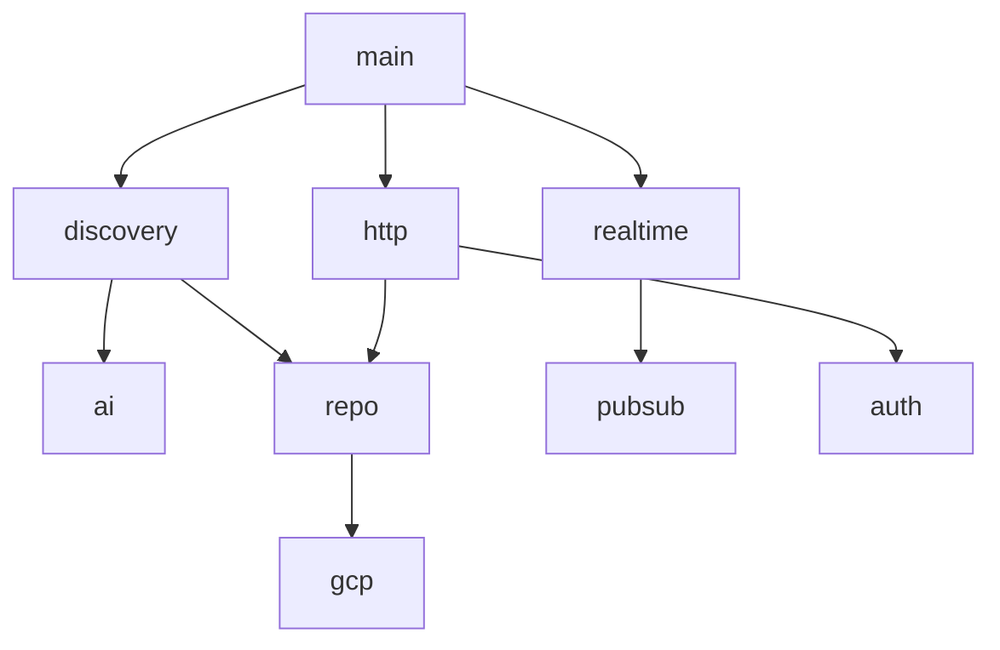

## Backend Overview

### Process Topology
- Entrypoint: `backend/cmd/server/main.go`
- HTTP/WS handlers: `backend/internal/http/*`, `backend/internal/realtime/ws.go`
- Core modules: `internal/ai`, `internal/discovery`, `internal/repo`, `internal/gcp`, `internal/realtime`, `internal/http`, `internal/telegram`

### Package Map

### Responsibilities
- Routing/auth, discovery/profiling orchestration, AI calls, repository access, realtime updates.

See module docs under `architecture/backend/modules/*`.

