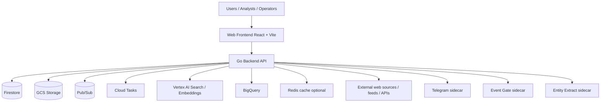

# Бизнес- и архитектурная спецификация Sanskrite

Статус: working spec  
Основание: кодовая база и актуальные документы репозитория на 2026-03-11

## 1. Назначение документа

Этот документ описывает систему Sanskrite как единый продукт и платформу:

- зачем система нужна бизнесу;
- какие продуктовые контуры в ней уже есть;
- из каких сервисов и данных она состоит;
- как проходят ключевые потоки от сигнала до аналитического результата;
- какие архитектурные ограничения и требования уже заложены в текущую реализацию.

Документ опирается не только на docs, но и на реальный код:

- `backend/cmd/server/main.go`
- `backend/internal/http/*`
- `backend/internal/discovery/*`
- `backend/internal/horizon/*`
- `backend/internal/realtime/*`
- `backend/internal/models/models.go`
- `python/event_gate_service/app.py`
- `python/entity_extract_service/app.py`
- `python/telegram_service/app.py`
- `web/src/App.tsx`
- `web/src/pages/HorizonPage.tsx`
- `web/src/lib/api.ts`

## 2. Executive Summary

Sanskrite это многоарендная аналитическая платформа для:

- подключения внешних источников информации;
- автоматического сбора и нормализации документов и сигналов;
- построения графа сущностей, событий, зависимостей и зон воздействия;
- генерации explainable-аналитики, risk surface и материалов для принятия решений;
- доставки результатов в веб-интерфейс в near real-time.

Система уже реализована как единый Go backend с несколькими продуктовыми поверхностями:

- `Discovery` для исследования источников, документов и source profiling;
- `Horizon` для графа, линз, supply chains, propagation, risk jobs и situational awareness;
- `Verified` для публичного анализа отдельного URL с потоковым статусом;
- `Artifacts` для AI-сборки динамических документов внутри проекта;
- вспомогательные сервисы подписки, биллинга, realtime, фонового polling и NLP sidecars.

Ключевой архитектурный принцип текущей реализации: бизнес-критичный ingest и orchestration живут в core backend, а model-sidecar сервисы остаются опциональными и не должны становиться hard dependency.

## 3. Бизнес-контекст

### 3.1 Проблема, которую решает система

Организациям, которые следят за рисками, геополитикой, цепочками поставок, организациями и внешними источниками, обычно не хватает единой системы, которая одновременно:

- умеет постоянно ingest-ить источники;
- превращает сырой контент в пригодную для анализа структуру;
- связывает сигналы с сущностями, территориями, рынками и зависимостями;
- объясняет не только что произошло, но и кого это затронет;
- предоставляет как операторский мониторинг, так и исследовательский режим.

### 3.2 Бизнес-цели

- Сократить время от появления внешнего сигнала до аналитически пригодного объекта.
- Превратить разрозненные документы и фиды в повторно используемое knowledge layer.
- Дать аналитикам и операторам единый workspace вместо набора ручных инструментов.
- Снизить стоимость мониторинга за счёт автоматического polling, дедупликации и staged enrichment.
- Создать основу для платных тарифов, premium analytics и enterprise use cases.

### 3.3 Целевые роли пользователей

- Аналитик: исследует тему, собирает источники, строит материалы и ответы.
- Risk/operator user: следит за изменениями в Horizon, смотрит impact paths и watch surfaces.
- Knowledge engineer/admin: управляет правилами, источниками, таксономией, политиками и качеством данных.
- External/public viewer: получает публичный результат по `Verified` ссылке.

## 4. Продуктовые контуры

### 4.1 Discovery

Назначение:

- исследование источников;
- запуск discovery по запросу;
- поиск и просмотр документов проекта;
- source profiling и анализ редакционной позиции/повестки;
- рабочая поверхность для источников, interactions и артефактов.

Основа в коде:

- `backend/internal/http/discovery.go`
- `backend/internal/discovery/poller_worker.go`
- `backend/internal/discovery/worldmonitor_pipeline.go`
- `web/src/pages/DiscoveryPage.tsx`

### 4.2 Horizon

Назначение:

- графовая модель мира и объектов;
- линзы (`Lens`) как пользовательские срезы анализа;
- scout pipeline для обнаружения и проверки фактов;
- propagation, risk pipeline, interpretation, QA и watchdog;
- map/activity, supply chains, fragments, profiles, scenarios, co-pilot.

Основа в коде:

- `backend/internal/horizon/service.go`
- `backend/internal/horizon/scout/*`
- `backend/internal/horizon/risk/pipeline.go`
- `backend/internal/http/horizon/*`
- `web/src/pages/HorizonPage.tsx`

### 4.3 Verified

Назначение:

- fast-turnaround анализ одного URL;
- создание системного проекта под конкретную ссылку;
- публичный доступ по короткому коду;
- прогресс через realtime streaming.

Основа в коде:

- `backend/internal/http/verified.go`
- `web/src/pages/VerifiedPage.tsx`
- `web/src/pages/VerifiedViewPage.tsx`

### 4.4 Artifacts

Назначение:

- сборка динамических документов из sections, prompts и context sources;
- хранение версий;
- auto-update;
- сохранение в storage и повторное использование как project artifact.

Основа в коде:

- `backend/internal/http/artifacts.go`
- `backend/internal/services/artifact_*`
- `backend/internal/models/models.go` (`CoreDoc`, `ArtifactConfig`)

### 4.5 Realtime collaboration layer

Назначение:

- доставка статусов discovery, artifact generation, verified analysis и Horizon jobs;
- подписка по tenant, project и verified code;
- создание ощущения живой системы без постоянного full refresh.

Основа в коде:

- `backend/internal/realtime/pubsub.go`
- `backend/internal/realtime/ws.go`

## 5. Бизнес-возможности системы

Система уже покрывает следующие capability blocks:

- Source onboarding: RSS, Telegram, Horizon feed, web/document sources.
- Continuous ingest: coordinated polling с lease/state model.
- Document layer: хранение, поиск, индексация, chunking, metadata sync.
- Ontology/graph layer: fragments, edges, facts, exposure paths, materialized artifacts.
- AI execution: LLM orchestration для extraction, critique, synthesis, explanation.
- Monitoring layer: signals, map activity, risk rollups, watch/watchdog.
- Delivery layer: web UI, share links, verified public pages, realtime streaming.
- Monetization layer: subscriptions, vouchers, PayPal-related subscription fields.

## 6. Архитектурные принципы

- Monolithic core, modular domains. Основная бизнес-логика собрана в одном Go backend, но разделена на bounded contexts.
- Event-driven updates. Состояние меняется через репозитории, а UI синхронизируется через Pub/Sub + WebSocket.
- Multi-tenant by design. Почти все сущности содержат `tenantId`; специальные system/global потоки выделены явно.
- Model-optional NLP. Python NLP services подключаются по HTTP и имеют deterministic fallback.
- Firestore-first operational model. Firestore используется как primary operational store для проектов, документов, графа и job state.
- Explainability over raw feed. Система ориентирована не просто на сбор новостей, а на объяснение impact и graph consequences.
- Project-centric UX. Discovery, artifacts и часть Horizon workflows привязаны к `Project`.

## 7. Контекстная архитектура

## 8. Логическая декомпозиция backend

### 8.1 Identity and access

- Firebase ID token authentication в `backend/internal/http/auth.go`.
- Dev fallback через Google OAuth access token включается env-флагом.
- Tenant определяется через `UsersRepository`; иначе часто используется email как fallback tenant key.
- Для system flows есть отдельный режим `IsSystem`.

### 8.2 Project and workspace core

- `Project` это верхняя бизнес-единица рабочей области.
- Поддерживаются разные `ProjectType`, включая `horizon`.
- Вокруг проекта группируются interactions, core docs, data sources, artifacts и public sharing.

### 8.3 Discovery domain

- `SourcePoller` координирует due sources и dispatch-ит per-source tasks.
- Поддерживаемые kinds в poller: `rss`, `telegram_channel`, `horizon_feed`, `worldmonitor_legacy`.
- Есть source runtime state, lease model, adaptive polling и auto-pause/resume логика.
- Horizon/WorldMonitor ingest идёт через выделенный pipeline, а не через generic document-only path.

### 8.4 NLP sidecars

- `event_gate_service` классифицирует статью как event vs analysis/advisory/broad_scope/noise.
- `entity_extract_service` выделяет сущности и geo/entity hints.
- Оба сервиса stateless, вызываются по HTTP, могут работать в rule/model/hybrid/shadow режимах.
- При ошибке backend должен продолжать ingest по deterministic rules.

### 8.5 Artifact domain

- `CoreDoc` может быть `static` или `dynamic_artifact`.
- Artifact состоит из секций, generation settings, версий, context snapshots и auto-update правил.
- Генерация оркестрируется отдельными сервисами и публикует realtime events.

### 8.6 Horizon domain

Поддомены:

- graph storage: `HorizonFragment`, `DependencyEdge`, `Frame`, `Lens`, `ExposurePath`, `MaterializedArtifact`;
- scout: planner, source executor, multi-agent extraction/critique/resolve;
- propagation: распространение изменений по графу;
- risk: staged pipeline от identify до alert;
- interpretation: explainable overlays и cached interpretations;
- profiles/QA: domain answer, fragment profiles, answer synthesis;
- watchdog: фоновые проверки и refresh;
- telemetry/policy/enforcement: контроль качества, telemetry и policy execution.

### 8.7 Realtime domain

- Pub/Sub topics агрегированы по типам событий.
- WebSocket hub умеет подписывать клиентов на tenant, project и verified code.
- Horizon, Verified, Discovery и Artifacts используют единый transport pattern.

### 8.8 Billing and subscription domain

- Тарифы: `free`, `pro`, `max`.
- Есть voucher-based activation и задел под recurring billing.
- В модели уже присутствуют PayPal plan/agreement/subscription identifiers.

## 9. Основные данные и их бизнес-смысл

### 9.1 Workspace data

- `Project`: контейнер рабочего контекста.
- `Interaction`: история пользовательских и системных взаимодействий.
- `CoreDoc`: прикреплённый документ или динамический артефакт.

### 9.2 Source intelligence data

- `DataSource`: источник наблюдения/ингеста.
- `SourceProfile`: мета-анализ поведения источника.
- `Document`/`Chunk`: нормализованные документы для поиска и grounding.

### 9.3 Horizon graph data

- `HorizonFragment`: базовый узел доменной модели.
- `DependencyEdge`: зависимость или отношение между узлами.
- `Frame`: результат scouting/verification на конкретный момент.
- `Lens`: пользовательский scope анализа.
- `RiskJob`, `ScoutingJob`: асинхронные процессы.
- `MaterializedArtifact`, `ExposurePath`: производные аналитические структуры.

### 9.4 Monetization and access data

- `Subscription`
- `Voucher`
- `ShareToken`
- `WaitlistEntry`

## 10. Ключевые end-to-end потоки

### 10.1 Source ingest и discovery

1. Пользователь или система создаёт `DataSource`.
2. `SourcePoller` определяет due sources и выдаёт lease.
3. Для RSS/Telegram/Horizon feed запускается соответствующий ingest path.
4. Документы сохраняются, при необходимости enrich-ятся и индексируются.
5. Результаты становятся доступны в Discovery UI, поиске и downstream аналитике.

### 10.2 Horizon Monitor / external signal pipeline

1. Horizon feed или legacy WorldMonitor source попадает в `worldmonitor_pipeline`.
2. Статья проходит heuristic classification.
3. При наличии конфигурации вызываются `event-gate` и `entity-extract`.
4. Pipeline решает:
   - создавать affected zone;
   - только warm existing object;
   - only signal;
   - suppress as non-event.
5. Сигналы и факты идут в graph/risk/propagation контуры.

### 10.3 Создание и сборка Lens

1. Пользователь открывает `/horizon`.
2. UI может сделать preflight по natural language запросу.
3. Backend создаёт `Lens` и запускает scouting pipeline.
4. Scout engine создаёт/обновляет fragments, frames, edges и связанные производные данные.
5. Realtime события двигают фронт из preflight/progress в рабочее состояние lens.

### 10.4 Horizon risk processing

Текущая staged модель в коде:

- `identify`
- `escalate`
- `apply`
- `seed`
- `propagate`
- `rollup`
- `interpret`
- `alert`

Пайплайн выполняется асинхронно, обновляет `RiskJob`, публикует stage/job events и использует fragment, edge, exposure path и interpretation services.

### 10.5 Verified URL analysis

1. System-authenticated клиент вызывает `POST /api/v1/verified`.
2. Backend создаёт системный `Project` и `ShareToken`, сохраняет metadata interaction.
3. Публикуется `verified.stream.fetch_start`.
4. Асинхронный процесс fetch/analysis заполняет проект данными.
5. Публичная страница `/verified/{code}` подписывается на события и/или poll-ит результат.

### 10.6 Artifact generation

1. В проекте создаётся `CoreDoc` с `docType=dynamic_artifact`.
2. Artifact orchestrator собирает context из interactions, docs, search и pinned messages.
3. Sections генерируются по отдельности.
4. Orchestrator собирает итоговый документ, версионирует его и может сохранять в GCS.
5. UI получает progress через artifact realtime events.

## 11. Frontend архитектура

Текущая фронтенд-модель:

- React + TypeScript + Vite.
- Firebase auth на клиенте.
- Axios API client с автоматической подстановкой ID token.
- Zustand stores для проектов, UI и realtime state.
- Основные маршруты:
  - `/` для homepage или Discovery;
  - `/horizon` для Horizon;
  - `/verified` и `/verified/:code`;
  - `/shared/:token`;
  - print pages для horizon profiles.

Практический вывод:

- фронтенд не содержит core business logic;
- основные вычисления, orchestration и data truth живут на backend;
- UI играет роль workspace shell и visualization/control plane.

## 12. Инфраструктура и runtime-модель

### 12.1 Основные технологии

- Go backend
- React/Vite frontend
- Python sidecars
- Firestore
- GCS
- Pub/Sub
- Cloud Tasks
- Vertex AI / Vertex AI Search
- BigQuery
- Firebase Auth / Hosting
- Redis как optional accelerator

### 12.2 Runtime topology

- Backend является главным orchestration node.
- Frontend обращается к backend по HTTP и WebSocket.
- Sidecars вызываются backend-ом по internal HTTP.
- Асинхронные работы раскладываются через Pub/Sub и Cloud Tasks.
- Firestore хранит primary operational state.
- GCS хранит document/artifact blobs.
- BigQuery используется для аналитических и SQL-heavy сценариев.

## 13. Мультитенантность и специальные tenants

В коде есть три режима работы с tenant scope:

- обычный tenant пользователя;
- `system` для Verified и системных операций;
- `global` для некоторых глобальных Horizon/system sources.

Это означает, что спецификация данных должна исходить не только из isolated tenant model, но и из существования shared/global operational lanes.

## 14. Нефункциональные требования

### 14.1 Надёжность

- Source polling не должен ломаться из-за падения NLP sidecar.
- Асинхронные процессы должны быть идемпотентными по job/source/document, насколько это возможно.
- При обрыве WS клиент должен иметь fallback через повторное подключение или polling.

### 14.2 Производительность

- Polling и risk/scout задачи должны быть вынесены из request path.
- Firestore запросы и индексы являются критической частью latency budget.
- Vertex Search и Redis используются как ускорители recall/lookup, а не как единственный источник правды.

### 14.3 Explainability

- Система должна хранить достаточные evidence links, source refs и job history.
- Особенно это важно в Horizon, где ценность строится на explainable impact paths.

### 14.4 Безопасность

- Все пользовательские API закрыты Firebase auth.
- Public access допускается через ограниченные share/verified tokens.
- Секреты и external credentials должны жить вне репозитория.

## 15. Архитектурные сильные стороны текущей реализации

- Хорошо выраженный backend-first orchestration подход.
- Сильное разделение между operational truth и optional model services.
- Реально работающая event-driven realtime схема.
- Общая платформа может поддерживать сразу несколько продуктовых поверхностей без отдельного backend на каждую.
- Horizon уже заложен как не просто knowledge graph, а как operational risk engine.

## 16. Ключевые архитектурные риски

- Очень широкий monolith: домены Discovery, Horizon, Verified, Artifacts и Billing уже живут в одном runtime и усложняют bootstrap.
- Firestore становится критической точкой и для graph state, и для job state, и для workspace state.
- Domain boundary между classic ontology/doc layer и Horizon layer местами размыта.
- Realtime transport единый и мощный, но требует аккуратного контроля event contracts.
- Часть продукта документирована сильнее, чем стабилизирована как formal public API.

## 17. Рекомендуемая трактовка системы для дальнейшего развития

Sanskrite стоит рассматривать как платформу из трёх уровней:

- `Operational Core`: auth, projects, sources, documents, interactions, subscriptions, realtime.
- `Knowledge & Analysis Core`: discovery pipelines, ontology/doc processing, artifacts.
- `Horizon Intelligence Layer`: graph, scouting, propagation, risk, monitoring, watch surfaces.

Для бизнеса это значит:

- Discovery можно развивать как research/copilot workspace.
- Horizon можно развивать как premium/operator product.
- Verified можно использовать как acquisition/demo/public entry point.
- Artifacts и subscriptions дают основу для monetization и tier differentiation.

## 18. Итог

На текущем этапе Sanskrite это не просто приложение для анализа текстов и не только графовая система. Это единая intelligence platform, где:

- ingestion превращает внешние сигналы в структурированные данные;
- graph/risk слой связывает события с последствиями;
- artifact и QA слои упаковывают результат в пользовательские deliverables;
- realtime и web UI делают систему пригодной для операторского использования.

Главный продуктовый смысл системы: перейти от “мы читаем источники” к “мы понимаем, что меняется в мире, кого это затрагивает и как это использовать в принятии решений”.
