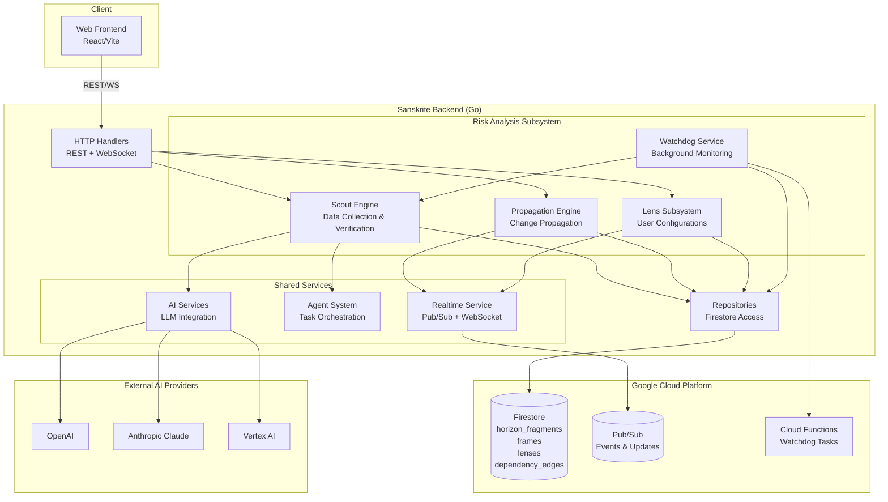

# Архитектурный обзор системы мониторинга горизонта

## Контекст системы

Система мониторинга горизонта является подсистемой платформы Sanskrite, интегрированной в моноядро. Она использует существующую инфраструктуру (Firestore, AI система, Agent система, Realtime) и добавляет специализированные компоненты для анализа рисков и зависимостей.

## Диаграмма контейнеров (C4 L2)



## Ключевые компоненты

### Scout Engine

**Назначение**: Автоматический сбор и верификация данных из внешних источников

**Архитектура "Зал Суда"**:
- **Scout Agent** — поиск и первичное извлечение информации в типизированный JSON
- **Critic Agent** — проверка данных на соответствие источникам и логическую когерентность
- **Resolver Agent** — финальное решение о статусе данных (Verified, Rejected, Low_Confidence)

**Интеграция**: Использует `internal/ai` для LLM вызовов и `internal/agents` для оркестрации задач

**Хранилище**: Создает `Frame` документы в Firestore коллекции `frames`

### Propagation Engine

**Назначение**: Распространение изменений в графе зависимостей с контролем вычислительной нагрузки

**Алгоритмы**:
- **Delta Threshold** — порог значимости изменений
- **Wave Damping** — затухание влияния при распространении
- **Lazy Evaluation** — приоритетный пересчет (Hot Path / Cold Path)
- **Topological Optimization** — обработка критических путей

**Интеграция**: Использует `internal/realtime` для публикации обновлений Lens

**Хранилище**: Читает `DependencyEdge` из Firestore коллекции `dependency_edges`

### Lens Subsystem

**Назначение**: Управление пользовательскими конфигурациями мониторинга и анализа

**Функции**:
- Создание и управление Lens
- Подписка на HorizonFragment
- Управление жизненным циклом узлов (active_subscribers)
- Конфигурация визуализации и оповещений

**Интеграция**: Связан с `Project` из основной системы, использует `internal/realtime` для обновлений

**Хранилище**: Коллекция `lenses` в Firestore

### Watchdog Service

**Назначение**: Фоновый мониторинг внешних источников и инициирование обновлений

**Функции**:
- Периодическая проверка источников для активных HorizonFragment
- Обнаружение изменений контента (trigger_threshold)
- Создание ScoutRequest для обновления данных
- Управление жизненным циклом (RUNNING/PAUSED на основе active_subscribers)

**Интеграция**: Использует Cloud Functions или Cloud Run Jobs для фоновых задач

**Хранилище**: Коллекция `watchdog_configs` в Firestore

## Использование существующих компонентов

### Firestore

**Коллекции для Risk Analysis**:
- `horizon_fragments` — узлы графа знаний
- `frames` — неизменяемые кадры данных от Scout
- `lenses` — пользовательские конфигурации
- `dependency_edges` — связи между узлами
- `watchdog_configs` — конфигурации мониторинга

**Индексы**: Создаются для эффективных запросов по canonical_path, tenant_id, status, active_subscribers

### AI система (`internal/ai`)

**Использование**:
- `AITaskExecutor` — выполнение LLM запросов для Scout/Critic/Resolver
- `AIService` интерфейс — абстракция над провайдерами (OpenAI, Claude, Vertex AI)
- Constrained Decoding — генерация строго типизированного JSON

**Модели**:
- Scout: GPT-5.2, Claude 4.5, Gemini 3 Pro
- Critic: Claude 4.5 Opus
- Resolver: GPT-5.2, Claude 4.5

### Agent система (`internal/agents`)

**Расширение**:
- Новые агенты: `ScoutAgent`, `CriticAgent`, `ResolverAgent`
- Использование существующего `AgentJob` для отслеживания состояния ScoutingJob
- Capabilities для различных этапов workflow (planning, extraction, validation, resolution)

### Realtime (`internal/realtime`)

**Использование**:
- Pub/Sub события для обновлений HorizonFragment
- WebSocket уведомления для обновлений Lens/Graph через общий realtime broker (`/ws`) + project subscription
- События: `horizon.assembly.*`, `horizon.scout.job.*`, `horizon.graph.node.upserted`, `horizon.propagation.started`, `horizon.lens.updated`

### Мультитенантность

**Реализация**:
- Все модели содержат `tenantId` поле
- Firestore коллекции используют `tenantId` как часть ключа
- Изоляция данных на уровне репозиториев

## Новые компоненты

### Scout Engine

**Расположение**: `backend/internal/horizon/scout/`

**Структура**:
```
scout/
├── engine.go              # Основной движок Scout
├── agents/
│   ├── scout_agent.go     # Агент извлечения данных
│   ├── critic_agent.go    # Агент валидации
│   └── resolver_agent.go  # Агент разрешения конфликтов
├── planner.go             # Планирование источников
└── executor.go            # Выполнение запросов к источникам
```

### Propagation Engine

**Расположение**: `backend/internal/horizon/propagation/`

**Структура**:
```
propagation/
├── engine.go              # Основной движок распространения
├── wave_damping.go        # Алгоритм затухания волны
├── threshold.go           # Пороги значимости
└── lazy_eval.go           # Ленивые вычисления
```

### Lens Subsystem

**Расположение**: `backend/internal/horizon/lens/`

**Структура**:
```
lens/
├── service.go            # Основной сервис Lens
├── subscription.go        # Управление подписками
└── calculator.go         # Пересчет метрик для Lens
```

### Watchdog Service

**Расположение**: `backend/internal/horizon/watchdog/`

**Структура**:
```
watchdog/
├── service.go            # Основной сервис Watchdog
├── monitor.go            # Мониторинг источников
└── scheduler.go          # Планирование проверок
```

## Поток данных

### Создание нового HorizonFragment

1. Пользователь создает Lens с указанием `canonical_path`
2. Lens Subsystem проверяет существование HorizonFragment
3. Если не существует → создается ScoutingJob (Pioneer модель)
4. Scout Engine выполняет сбор данных через архитектуру "Зал Суда"
5. Создается Frame с верифицированными данными
6. HorizonFragment создается/обновляется в Firestore
7. Watchdog конфигурация создается для активного узла
8. Propagation Engine пересчитывает зависимые Lens

### Обновление существующего HorizonFragment

1. Watchdog обнаруживает изменение в источнике
2. Создается ScoutRequest для обновления
3. Scout Engine выполняет сбор и верификацию
4. Новый Frame создается с обновленными данными
5. HorizonFragment обновляется (версионирование)
6. Propagation Engine проверяет порог значимости (Delta Threshold)
7. Если превышен → запускается волна распространения изменений
8. Зависимые Lens пересчитываются (Hot Path / Cold Path)
9. Realtime события публикуются для обновления UI

## Масштабируемость

### Вычислительная устойчивость

- **Wave Damping** предотвращает экспоненциальный рост нагрузки
- **Delta Threshold** фильтрует незначительные изменения
- **Lazy Evaluation** приоритизирует активные Lens
- **Topological Optimization** обрабатывает критические пути первыми

### Хранилище

- Firestore автоматически масштабируется
- Индексы оптимизированы для частых запросов
- Версионирование HorizonFragment хранится в time-series коллекции

### Мониторинг

- Watchdog работает только для активных узлов (active_subscribers > 0)
- Неактивные узлы переходят в Dormant состояние
- Архивация узлов после периода неактивности

## Безопасность

- Мультитенантная изоляция через TenantID
- Контроль доступа на уровне Lens (связь с Project)
- Валидация данных через архитектуру "Зал Суда"
- Аудит через Frame с полной цепочкой доказательств

## См. также

- [Модель данных](data-model.md)
- [Интеграция с Sanskrite](integration.md)
- [Компоненты системы](components.md)

