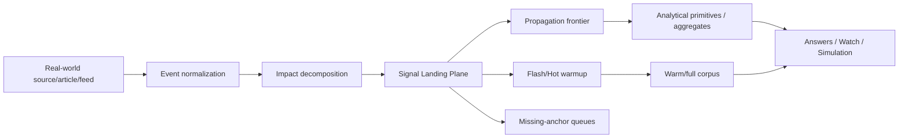

# Signal Landing Plane

## Статус документа

Этот документ описывает первый слой long pipeline для Horizon:

- как сигнал из реального мира превращается в набор impact claims
- как claims приземляются на существующие сущности в графе и materialized substrate
- как система фиксирует `landed`, `inferred` и `missing` anchors
- как это связано с `flash / hot / warm / full` прогревом
- как использовать Vertex и candidate queues так, чтобы сигнал сначала хорошо попадал в мир, а уже потом хорошо интерпретировался в ответах

Это не документ про UI и не документ про LLM-answering.
Это документ про `signal landing` как source-of-truth слой для всего downstream risk runtime.

## Почему этот слой стал главным

На текущем этапе системы уже заметно улучшены:

- factual substrate
- materialized supply-chain artifacts
- analytical primitives и aggregates
- temperature-based warmup
- bounded delta refresh

Но качество ответа всё ещё ограничено не столько прогревом, сколько качеством первого попадания сигнала в систему.

Сейчас главный вопрос уже не:

- `как красиво интерпретировать риск?`

а:

- `что именно в мире произошло?`
- `на какие сущности в системе это должно лечь?`
- `что из этого в графе уже найдено?`
- `что явно важно, но в графе отсутствует и должно пойти в доразведку?`

Примеры:

- удар по Катару должен садиться не только на `/loc/qa`, но и на LNG, helium, Ras Laffan, energy export infrastructure, chokepoints и downstream dependencies
- блокировка Ормуза должна садиться не только на географию, но и на chokepoint, path families, energy flows и product-level dependencies, включая те сущности, которых в графе ещё не хватает

Если этот слой слабый, downstream-аналитика неизбежно будет:

- слишком общей
- слишком дорогой
- слишком зависимой от LLM интерпретации
- плохо масштабируемой по миру

## Что уже есть в коде

В текущем runtime уже есть сильные части этого слоя.

### 1. Event -> signal extraction

Пакет:

- `backend/internal/horizon/signals/extractor.go`
- `backend/internal/horizon/scout/signal_pipeline.go`

Что уже хорошо:

- есть rule-based extraction
- есть LLM fallback extraction
- один event может порождать несколько signal descriptors
- есть baseline escalation assessment

Ограничение:

- extracted signal ещё не является полноценным landed impact object
- downstream runtime не различает явно:
  - `confirmed landed refs`
  - `inferred landed refs`
  - `missing but important refs`

### 2. Deterministic seed grounding

Пакет:

- `backend/internal/horizon/signals/seed_injector.go`

Что уже хорошо:

- exact canonical path lookup
- country/location fallback
- semantic seed resolution
- applicability filtering
- attachment of `chainRefs` from materialized artifacts
- bounded caps for expensive fallbacks

Это уже очень полезный каркас signal landing.

Ограничение:

- seed resolution мыслит в основном как поиск seed fragments для propagation
- система не материализует полноценный landing object с explainable hit taxonomy
- нет нормального missing-anchor loop

### 3. Vertex grounding evidence for existing entities

Пакет:

- `backend/internal/horizon/scout/grounding_resolver.go`
- `backend/internal/ai/vertex_search_client.go`

Что уже хорошо:

- grounding evidence умеет подтягивать datastore fragment IDs
- потом resolver загружает реальные Firestore fragments
- это уже правильный механизм `LLM suggests -> system grounds against DB`

Ограничение:

- механизм используется точечно
- он не оформлен как first-class слой `signal landing`
- не отделены роли Vertex:
  - `Vertex for grounding`
  - `Vertex for answering`

### 4. Worldmonitor / affected-zone / watch bridge

Пакет:

- `backend/internal/discovery/worldmonitor_pipeline.go`

Что уже хорошо:

- есть event classification
- есть affected-zone inference
- есть watch trigger hook
- есть fallback anchors на событие/страну
- есть map activity / worldmonitor heuristics

Ограничение:

- слой всё ещё часто слишком сильно опирается на affected zone как на единственную форму посадки
- локальные operational incidents могут не материализоваться в zone и теряться как `matched_zones=0`
- route/product/chokepoint landing не оформлен как равноправный первый результат

### 5. Watch monitoring already reads facts, but too shallowly

Пакет:

- `backend/internal/horizon/watchruntime/monitoring.go`
- `backend/internal/horizon/watchdog/monitor.go`

Что уже хорошо:

- watch runtime умеет читать signal facts по canonical paths
- watchdog умеет триггериться от semantic score signal facts

Ограничение:

- monitoring snapshot сейчас строится как lightweight fact bundling, а не как полноценная signal landing summary
- watch layer не является primary owner landing knowledge

## Главная архитектурная идея

Нужен отдельный слой:

- `Signal Landing Plane`

Его место в общей архитектуре:

Ключевой принцип:

- landing должен происходить раньше и жёстче, чем interpretation
- систему нужно делать сильной в попадании сигнала в реальный субстрат
- interpretation на конце может оставаться относительно лёгкой

## Что такое signal landing

`Signal Landing` — это materialized internal knowledge о том, как конкретный event/signal соотносится с сущностями системы.

Это не просто:

- `event exists`
- `signal exists`

Это:

- `какие impact claims были извлечены`
- `на какие refs они приземлились`
- `какие refs были выведены через graph expansion`
- `какие важные refs не найдены, но явно нужны`

## Базовый контракт

### 1. SignalLandingSession

Один event/article может порождать одну session.

Поля:

- `id`
- `tenantId`
- `sourceEventId`
- `sourceFactId`
- `sourceDocumentRefs`
- `createdAt`
- `updatedAt`
- `status`
- `landingVersion`
- `decompositionVersion`
- `groundingVersion`
- `expansionVersion`
- `coverageSummary`

Назначение:

- трассировать полный landing flow
- иметь idempotent container для replay/re-evaluation

### 2. ImpactClaim

Базовая единица смысла, extracted from event.

Примеры:

- `Qatar LNG export disruption`
- `Qatar helium export disruption`
- `Hormuz maritime chokepoint disruption`
- `RO membrane logistics blocker`

Поля:

- `id`
- `sessionId`
- `claimKind`
- `axis`
- `mechanism`
- `severity`
- `confidence`
- `timeHorizon`
- `sourceTextSpans`
- `sourceEvidenceRefs`
- `claimLabels`
- `claimAliases`
- `countryHints`
- `productHints`
- `routeHints`
- `facilityHints`
- `orgHints`
- `zoneEligibility`
- `affectedZoneRefs`
- `missingPreciseZone`

`zoneEligibility`:

- `required`
- `allowed`
- `forbidden`

### 3. LandingHit

Результат посадки claim на конкретный ref.

Поля:

- `id`
- `sessionId`
- `claimId`
- `canonicalRef`
- `refKind`
- `landingClass`
- `landingMethod`
- `confidence`
- `importance`
- `why`
- `supportingEvidenceRefs`
- `supportingPaths`
- `createdAt`

`landingClass`:

- `confirmed`
- `inferred`

`landingMethod`:

- `exact_canonical`
- `canonical_dictionary`
- `vertex_grounding`
- `graph_expansion`
- `path_family_expansion`
- `zone_anchor`
- `country_anchor`
- `materialized_chain`

### Affected zones are categorical, not universal

`Affected zone` не является обязательным выходом для любого события с географией.

Он обязателен только для категорий, где зона по смыслу есть как:

- территория встряски
- территория нарушения
- территория физического, санитарного, военного или системного воздействия

Сюда относятся, например:

- `military_conflict`
- `infrastructure_disruption`
- `cyber_disruption`
- `humanitarian_crisis`
- `disease_outbreak`
- `natural_disaster`
- `earthquake_affected`
- `flood_zone`
- `wildfire_zone`
- другие аналогичные shock/disruption classes

Сюда не относятся:

- праздники
- корпоративные новости
- сделки
- обычные назначения
- локальные деловые события без territorial shock semantics

То есть affected zone в Signal Landing Plane должна быть:

- `required` для zone-eligible disruption classes
- `allowed` для mixed operational cases
- `forbidden` для non-shock and non-zone event classes

Это согласуется с уже существующей логикой affected-zone inference в `worldmonitor_pipeline.go`.

### 4. MissingAnchorCandidate

Если claim говорит, что важная сущность есть, а runtime её не нашёл, это не должно теряться.

Поля:

- `id`
- `sessionId`
- `claimId`
- `candidateKind`
- `label`
- `normalizedLabel`
- `candidateAliases`
- `hintCountry`
- `hintGeo`
- `hintProductClass`
- `hintRouteClass`
- `hintIndustry`
- `suggestedCanonicalPath`
- `reason`
- `importance`
- `confidence`
- `suggestedSourceRefs`
- `needs`
- `status`
- `createdAt`

`candidateKind`:

- `entity`
- `facility`
- `product`
- `route`
- `chokepoint`
- `dependency`

`needs`:

- `fragment_bootstrap`
- `canonical_product_review`
- `transform_review`
- `route_profile_review`
- `watch_subject_bootstrap`
- `path_family_backfill`

## Четыре прохода landing

### Pass A. Deterministic anchors

Сначала система делает дешёвую и строгую посадку:

- geography refs
- affected zone refs when `zoneEligibility=required|allowed`
- known chokepoints
- ports / borders / airports
- known organizations
- known facilities
- canonical products через control plane
- materialized artifact refs

Источники:

- `SeedInjector.ResolvePath`
- canonical product dictionaries
- known worldmonitor place/entity rules
- exact fragment lookup
- materialized artifact keys / refs

Это должно покрывать большую часть high-value событий без LLM-heavy этапов.

### Pass B. Semantic grounding through Vertex

Если deterministic landing не закрыл claim, включается Vertex как grounding engine, а не как answering engine.

Тут Vertex должен решать задачи:

- alias resolution
- product grounding
- facility nickname grounding
- route/corridor grounding
- entity family grounding

Важно:

- Vertex должен искать прежде всего по `grounding`-корпусу, а не по answer corpus
- retrieved docs должны возвращать реальные fragment refs / path refs / product refs
- поиск должен заканчиваться not только doc hit, но и grounded ref decision

### Pass C. Graph-aware expansion

Когда anchor найден, система должна сделать controlled expansion.

Примеры:

- `/loc/qa` -> Ras Laffan -> LNG -> helium -> downstream terminals
- `/loc/int/strait-of-hormuz` -> affected path families -> critical ports -> exposed products

Для expansion использовать:

- graph dependencies
- materialized artifacts
- path families
- chokepoint dependencies
- product transforms / assemblies
- analytical primitives

Важно:

- expansion должен быть bounded
- это не full-world scan
- topological expansion должен быть policy-driven

### Pass D. Missing-anchor capture

Если claim явно указывает на важную сущность, но система её не находит:

- она не должна пропасть
- она должна стать first-class output

Например:

- статья говорит о `reverse osmosis membranes`
- граф знает desalination / logistics / Hormuz, но не знает конкретный product path
- система должна сохранить:
  - missing product candidate
  - missing dependency candidate between Hormuz and that product family

Это особенно важно для:

- industrial parts
- chemicals
- service parts
- route-specific components
- second-order product impacts

## Как использовать canonical control plane

Для supply-chain signal landing canonical product control plane обязателен.

Правила:

1. Product landing не должен строиться по raw labels, если продукт можно canonicalize.
2. Product synonym dictionary и transform dictionary не смешиваются.
3. Если event/claim указывает на product alias, сначала идём в synonym dictionary.
4. Если event/claim указывает на dependency/transform relationship, идём в transform dictionary.
5. Если product или product pair неизвестны:
   - не придумываем ad hoc path
   - пишем в candidate collections

Новые candidate collections для первого слоя:

- `horizon_signal_missing_entity_candidates`
- `horizon_signal_missing_facility_candidates`
- `horizon_signal_missing_product_candidates`
- `horizon_signal_missing_route_candidates`
- `horizon_signal_missing_dependency_candidates`

Для product и product pair candidates нужно интегрироваться с уже существующими queues:

- `horizon_product_synonym_candidates`
- `horizon_product_transform_candidates`

## Как разделить роли Vertex

Сейчас Vertex в системе уже используется как retrieval substrate.
Но роли должны быть разделены.

### 1. Grounding Vertex

Назначение:

- entity grounding
- product grounding
- route grounding
- facility grounding
- alias resolution

Требования:

- индексировать refs и aliases
- хранить `canonicalRef`, `kind`, `tenantId`, `country`, `industry`, `pathFamilyIds`, `productPaths`
- приоритет точного и high-confidence hit
- low-latency search

### 2. Answer Vertex

Назначение:

- semantic retrieval для ответов
- reading warmed factual / analytical documents

Требования:

- rich corpus
- analytical docs
- long-form context

Нельзя смешивать их в одну логическую роль.

Если смешать:

- grounding становится шумным
- answer retrieval начинает тащить слишком много operational alias logic

## Что именно прогревать по температурам

Прогрев не должен означать `готовый ответ на любой вопрос`.
Он должен означать `подготовленный landing-aware substrate`.

### Flash

Цель:

- дать первый полезный hit сигнала за секунды или меньше минуты

Что греть:

- geography anchors
- chokepoint anchors
- port/border/airport anchors
- compiled watch subjects
- top path families
- recent signal landing sessions
- recent landing hits
- recent missing-anchor candidates

### Hot

Что греть:

- signal-aware product families
- signal-aware path families
- top landed refs around active watch subjects
- top landed refs around active lenses
- top analytical aggregates built from recent landing hits

### Warm

Что греть:

- richer lens-level analytical summaries
- path-family capsules
- supply-chain dependency summaries
- downstream industry exposure summaries

### Full

Что греть:

- whole-corpus semantic coherence
- broad analytical context
- scenario-ready substrate
- long-tail references and supporting docs

Ключевой принцип:

- `flash` и `hot` должны зависеть прежде всего от signal landing
- `warm` и `full` уже дают richer explanation

## Что нужно материализовать

Нужны новые persisted object families.

### 1. SignalLandingSession

Primary audit object.

### 2. ImpactClaim

Primary interpretive-but-structured object.

### 3. LandingHit

Primary grounding object.

### 4. MissingAnchorCandidate

Primary growth / backfill object.

### 5. SignalLandingSummary

Compressed summary for:

- watch runtime
- hot warmup
- answer prewarm

Поля:

- `scopeRef`
- `sessionIds`
- `topConfirmedRefs`
- `topInferredRefs`
- `topMissingCandidates`
- `topClaims`
- `products`
- `routes`
- `facilities`
- `chokepoints`
- `updatedAt`

## Где это должно рождаться в runtime

### 1. In worldmonitor / event ingestion

После event normalization должен появляться `ImpactDecomposer`.

Новая линия:

- `document/article`
- `normalized event`
- `impact claims`
- `deterministic landing`
- `vertex grounding`
- `graph expansion`
- `missing-anchor capture`
- `signal landing summary`
- потом уже `signal injection / propagation`

### 2. In signal pipeline

`SignalPipeline` должен перестать быть только:

- extract -> inject -> propagate

И стать:

- extract
- decompose
- land
- inject from landed refs
- propagate
- emit landing summary

### 3. In watch runtime

Watch runtime должен читать не только raw signal facts.

Он должен читать:

- recent landing summaries
- recent landing hits
- top missing candidates

Именно они должны строить:

- `sourceCoverage`
- `signalCount`
- `coverage gaps`
- `recommendedEscalation`

### 4. In warmup

`flash/hot` warmup должен брать:

- signal landing summaries
- top landing hits
- top missing candidates
- top recent propagated exposures

Это позволит быстро отвечать на вопросы:

- `what is currently affecting Saudi Arabia`
- `what around Hormuz is currently at risk`

без full corpus rebuild.

## Предлагаемые новые пакеты и зоны ответственности

### `backend/internal/horizon/signallanding/`

Новый пакет.

Подпакеты:

- `decomposer.go`
- `grounder.go`
- `expander.go`
- `missing.go`
- `service.go`
- `policy.go`

Роли:

- `decomposer`: event -> impact claims
- `grounder`: claim -> confirmed/inferred refs
- `expander`: landed refs -> expanded refs
- `missing`: unresolved important anchors -> candidate queues
- `service`: orchestration and persistence

### Existing packages to integrate, not replace

- `signals/` -> extraction and seed policies
- `scout/` -> signal pipeline orchestration
- `worldmonitor_pipeline.go` -> ingestion + event normalization
- `watchruntime/` -> consumers of landing summaries
- `analytical/` -> downstream aggregates
- `internalknowledge/` -> warmup consumers

## Recommended persistence layout

Firestore collections:

- `horizon_signal_landing_sessions`
- `horizon_signal_impact_claims`
- `horizon_signal_landing_hits`
- `horizon_signal_landing_summaries`
- `horizon_signal_missing_entity_candidates`
- `horizon_signal_missing_facility_candidates`
- `horizon_signal_missing_product_candidates`
- `horizon_signal_missing_route_candidates`
- `horizon_signal_missing_dependency_candidates`

Если нужно компрессировать число коллекций, можно хранить candidates в одной коллекции:

- `horizon_signal_missing_candidates`

с полем `candidateKind`.

Но бизнес-операционно раздельные коллекции часто проще для review loops.

## Что считать успехом

Нужны отдельные метрики качества первого слоя.

### Landing metrics

- `% events with at least one confirmed landed ref`
- `% events with product-level landed refs`
- `% events with chokepoint/route landed refs`
- `% events with remote endpoint landed refs after expansion`
- `% events with missing-anchor candidates`

### Time metrics

- `time to first landed hit`
- `time to first product hit`
- `time to first remote endpoint hit`
- `time to flash warmup`
- `time to hot summary availability`

### Coverage metrics

- `confirmed refs per event class`
- `inferred refs per event class`
- `missing candidates per event class`
- `signal landing coverage by geography`
- `signal landing coverage by industry`

### Precision metrics

- `false positive landing rate`
- `vertex grounding disagreement rate`
- `claim -> ref validation disagreement rate`

## Как тестировать e2e

Нужны реальные сценарии, не только smoke.

### Scenario class A. Geography + infrastructure shock

Примеры:

- удар по Катару
- shutdown Ras Laffan

Что проверять:

- landing на `/loc/qa`
- landing на LNG and helium products
- landing на Ras Laffan and export facilities
- missing candidates, если чего-то нет
- propagation to remote terminals / downstream industries

### Scenario class B. Chokepoint disruption

Примеры:

- Hormuz blockade
- GPS jamming in Hormuz

Что проверять:

- landing на chokepoint ref
- landing на route/path families
- landing на dependent products and corridors
- missing dependency capture for second-order products

### Scenario class C. Local operational incident

Примеры:

- Port of Hamburg weather disruption
- strike at key battery facility

Что проверять:

- signal не теряется, даже если affected zone не родилась
- event fallback anchor существует
- facility/port landing фиксируется
- `flash/hot` warmup ограничен локальным neighborhood

### Scenario class D. Product-specific second-order dependency

Примеры:

- desalination membrane blockers through Hormuz
- industrial gas downstream exposure from helium shortage

Что проверять:

- landing не ограничивается только географией
- product claim materializes
- если product missing, candidate queue фиксируется

## Что в текущем коде нужно переделать первым

### 1. Вынести impact decomposition в first-class service

Сейчас extraction и signal creation тесно сцеплены.

Нужно разделить:

- `extract signal descriptor`
- `decompose event into impact claims`

### 2. Сделать `SignalLandingService`

Он должен стать owner для:

- session
- claims
- landing hits
- missing candidates
- landing summaries

### 3. Развести `Vertex grounding` и `Vertex answering`

Нужно:

- отдельный grounding-aware datastore or struct filter mode
- отдельные request helpers and thresholds

### 4. Подключить canonical product control plane в landing

Для product mentions и product dependencies это обязательно.

### 5. Подключить watch runtime к landing summaries

Сейчас watch monitoring живёт слишком близко к raw signal facts.

Ему нужен materialized landing-aware substrate.

### 6. Подключить warmup builder к landing summaries

`flash/hot` нужно строить не только из factual docs и analytical aggregates,
но и из свежих signal landing summaries.

## Что это даст продуктово

Если слой сделан правильно, система получит:

1. Более высокий hit-rate реальных сигналов на сущности.
2. Меньше зависимости от тяжёлой LLM интерпретации на ответе.
3. Лучше bounded warmup вокруг реально затронутых зон.
4. Явный growth loop: что в мире важно, но в графе ещё отсутствует.
5. Более качественные risk answers без глобального перегрева мира.

## Главное правило

Система не должна пытаться заранее знать ответ на любой вопрос.

Она должна:

- хорошо понимать impact claims
- хорошо сажать их на реальные refs
- честно фиксировать то, чего в графе нет
- быстро прогревать только затронутые категории

Если сделать это хорошо, ответы станут быстрее и качественнее не потому, что LLM стал умнее,
а потому, что внутренний substrate стал ближе к реальному миру.
