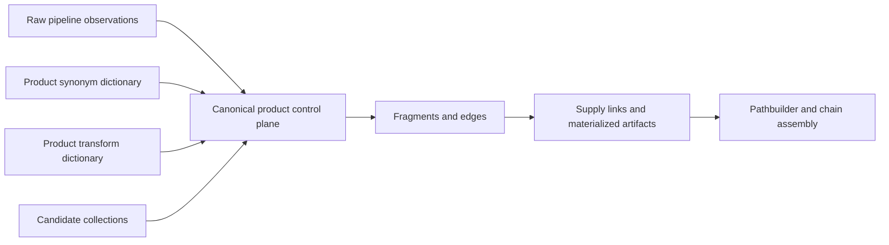

# Supply Chain Canonical Control Plane

## Статус документа

Это верхнеуровневый архитектурный документ про опорный слой supply-chain ядра.

Если агент или разработчик работает с:
- продуктами
- продуктовой таксономией
- product-to-product edges
- supply-chain paths
- materialized artifacts
- links / legs / assembly graphs

то этот документ нужно прочитать одним из первых.

## Зачем этот слой существует

В supply-chain графе есть два самых дорогих источника хаоса:

1. Один и тот же продукт появляется под разными именами и путями.
2. Переходы между продуктами фиксируются непоследовательно:
   иногда как `TRANSFORMS_INTO`, иногда как `ASSEMBLES_INTO`, иногда как грубый `DEPENDS_ON`, иногда только через materialized path.

Если это не стабилизировать, вся downstream-логика начинает деградировать:
- pathbuilder строит рваные цепочки
- materialized artifacts несут alias-хвосты
- supply links и legs расходятся по разным именам одного продукта
- новые пайплайны плодят всё больше почти-одинаковых узлов и почти-одинаковых product pairs

Поэтому в системе введён отдельный control plane для supply chain:

- canonical product identities
- canonical product synonyms
- canonical product transformation / assembly pairs
- candidate queues для всего, что ещё не вошло в канон

Это не локальная эвристика и не разовая чистка данных.
Это фундаментальный слой, на который теперь должен опираться весь supply-chain runtime.

## Что входит в control plane

### 1. Canonical products

Базовая единица продуктовой идентичности в системе — это не сырое название, а канонический product path.

Например:
- `Aluminium`
- `Aluminum`
- `Primary Aluminium`

могут вести к одному каноническому product identity, если это один и тот же продукт, а не разные стадии/классы.

### 2. Product synonym dictionary

Отдельный справочник, который хранит пары:

- `canonical product -> synonym`

Назначение:
- сводить разные названия одного и того же продукта к одному эталону
- не давать графу разрастаться из-за alias-вариантов
- приводить incoming product refs к одному canonical path до дальнейшей обработки

Важно:
- это только про идентичность
- это не про передел
- это не про upstream/downstream

Примеры допустимого смысла:
- `LNG = liquefied natural gas`
- `caustic soda = sodium hydroxide`
- singular/plural пары, где канон остаётся в singular

Примеры недопустимого смысла:
- `alumina != aluminum`
- `natural gas != LNG`
- `battery cell != battery pack`

### 3. Product transform dictionary

Отдельный справочник, который хранит пары:

- `from product -> to product`

Назначение:
- фиксировать ближайшие канонические шаги переработки, производства или сборки
- делать из коротких шагов длинные цепочки
- стабилизировать product-to-product semantics для pathbuilder и materialization

Теперь каждая пара содержит явный `relationKind`:
- `transformation`
- `assembly`

Это важно, потому что химический/технологический передел и сборочный шаг не одно и то же, даже если оба пригодны для построения цепочек.

### 4. Candidate queues

Вся новая неизвестность не должна бесконтрольно расползаться по графу.

Если runtime не нашёл:
- product synonym match
- canonical transform / assembly pair

он не блокирует пайплайн, а пишет наблюдение в candidate collections:

- `horizon_product_synonym_candidates`
- `horizon_product_transform_candidates`

Это feedback loop для последующего review и пополнения эталонных словарей.

## Где этот слой находится в архитектуре

Этот слой стоит между общей таксономией и фактическим supply-chain runtime.

То есть:
- таксономия задаёт общий язык
- canonical control plane задаёт продуктовую идентичность и допустимые product steps
- уже после этого строятся фрагменты, edges, supply links, materialized paths и длинные цепочки

## Отношение к runtime taxonomy

Важно не смешивать два слоя:

### Runtime taxonomy

Это backend source of truth для:
- relation types
- event types
- sphere paths
- разрешённых vocabularies

Она живёт в `horizon_taxonomy`.

### Canonical product control plane

Это отдельный слой product identity и product transitions.

Он живёт не в одном общем taxonomy blob, а в отдельных Firestore collections:
- `horizon_product_synonym_pairs`
- `horizon_product_transform_pairs`
- candidate collections для новых наблюдений

Причина простая:
- product identity и product transitions растут как operational dictionaries
- их нужно обновлять отдельно
- у них другой lifecycle, другие review loops и другой blast radius

## Как это работает в runtime

После внедрения в ядро система работает так.

### Product creation / resolve

Если incoming product path есть в synonym dictionary:
- он схлопывается к canonical path

Если нет:
- продукт не блокируется
- он сохраняется как есть
- наблюдение уходит в synonym candidate collection

### Product-to-product edges

Если pair есть в transform dictionary:
- relation нормализуется к каноническому product step
- edge приводится к `TRANSFORMS_INTO` или `ASSEMBLES_INTO` согласно `relationKind`

Если pair нет:
- edge может быть сохранён пайплайном
- но наблюдение уходит в transform candidate collection

### Materialized artifacts

Перед сохранением materialized artifacts:
- product refs
- `nodeRefs`
- `productAxis`
- embedded product paths в payload

тоже прогоняются через product synonym dictionary.

Это значит, что materialized layer не должен жить в старых alias-paths, если канон уже известен.

## Какие части ядра должны считать этот слой обязательным

Этот слой обязателен для:

- `CanonicalPathResolver`
- repositories, создающих или обновляющих `PRODUCT` fragments
- repositories, создающих product-to-product edges
- `SUPPLY_LINK` fragments, где есть `productRef`
- materialized artifacts
- pathbuilder
- всех будущих extractors, которые генерируют product refs или product steps

Нельзя считать raw product name или raw product path источником правды, если runtime может спросить canonical control plane.

## Бизнес-смысл

С точки зрения бизнеса это означает следующее.

### 1. У системы появился единый продуктовый язык

Теперь supply-chain ядро может говорить не в терминах:
- как LLM назвал продукт в этот раз
- как его назвал конкретный источник
- как он однажды попал в граф

а в терминах:
- эталонного продукта
- эталонного product path
- эталонного канонического перехода между продуктами

### 2. Длинные цепочки становятся собираемыми

Если короткие product steps стабильны, из них можно строить длинные цепочки:
- от сырья
- через переработку и intermediate materials
- через manufacturing и assembly
- до конечных finished products

Без этого любая длинная цепочка начинает рваться на alias-вариантах и непоследовательных relation types.

### 3. Новая неизвестность не теряется

Раньше неизвестный product alias или неизвестная product pair просто добавляли хаос.

Теперь:
- известное схлопывается
- неизвестное ставится в очередь на review

Это делает систему расширяемой без остановки runtime.

## Что downstream-агенты должны считать истинным

Любой агент, работающий с supply-chain кодом или данными, должен исходить из следующих правил.

### Правило 1

Продуктовая идентичность определяется canonical product path, а не сырым названием.

### Правило 2

Synonym dictionary решает задачу identity, но не задачу transformation.

### Правило 3

Transform dictionary решает задачу допустимых product steps, но не задачу synonym equivalence.

### Правило 4

Если runtime already canonicalized product refs, downstream-код не должен пытаться заново решать ту же задачу локальными ad hoc эвристиками.

### Правило 5

Если новый продукт или product pair не найдены в словаре, они должны попадать в candidate layer, а не исчезать и не плодить бесконтрольный мусор.

## Что это меняет для будущей разработки

Любое изменение в supply-chain ядре теперь нужно оценивать так:

1. Использует ли оно canonical product identity?
2. Использует ли оно canonical transform / assembly pairs?
3. Пишет ли оно unknown cases в candidate queues?
4. Не создаёт ли оно новый параллельный словарь product identity мимо этого control plane?

Если ответ на пункт 4 — да, это почти наверняка архитектурный регресс.

## Связанные документы

- [Product Canonical Names And Paths](/Users/kirisyuk/cursor/sanskrite/docs/canonical_names_and_paths/PRODUCT_CANONICAL_NAMES_AND_PATHS.md)
- [Product Canonical Transforms](/Users/kirisyuk/cursor/sanskrite/docs/canonical_names_and_paths/PRODUCT_CANONICAL_TRANSFORMS.md)
- [Supply Chain Canonicalization](/Users/kirisyuk/cursor/sanskrite/docs/horizon/supply-chain-canonicalization.md)
- [Taxonomy](/Users/kirisyuk/cursor/sanskrite/docs/horizon/architecture/taxonomy.md)
