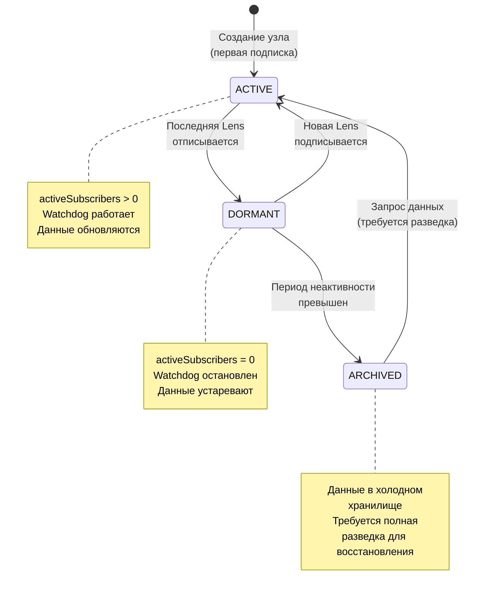

# Жизненный цикл HorizonFragment

## Обзор

Жизненный цикл HorizonFragment управляется на основе количества активных подписок (activeSubscribers) от Lens. Система автоматически переводит узлы между состояниями для оптимизации использования ресурсов.

## Состояния жизненного цикла

### ACTIVE (Активное состояние)

**Условие**: `activeSubscribers > 0`

**Характеристики**:
- Узел активно используется хотя бы одной Lens
- Данные регулярно обновляются через Scout Engine
- Watchdog работает и мониторит источники
- Propagation Engine выполняет пересчеты при изменениях

**Действия системы**:
- Регулярные обновления данных через Scout (на основе Watchdog конфигурации)
- Активный мониторинг источников через Watchdog
- Немедленный пересчет зависимых Lens при изменениях (Hot Path)
- Хранение данных в горячем хранилище (Firestore)

**Пример**:
```json
{
  "id": "fragment-123",
  "canonicalPath": "/fac/tsmc/fab-21",
  "governance": {
    "activeSubscribers": 3,
    "status": "ACTIVE"
  },
  "metadata": {
    "lastUpdatedAt": "2025-12-17T14:30:00Z",
    "lastVerifiedAt": "2025-12-17T14:25:00Z"
  }
}
```

### DORMANT (Спящее состояние)

**Условие**: `activeSubscribers == 0`

**Характеристики**:
- Узел не используется ни одной активной Lens
- Данные перестают обновляться
- Watchdog остановлен
- Данные начинают устаревать

**Переход в DORMANT**:
- Происходит автоматически при отписке последней Lens
- Счетчик `activeSubscribers` становится равен 0
- Статус узла меняется на DORMANT
- Watchdog конфигурация переводится в статус PAUSED

**Действия системы**:
- Остановка Watchdog мониторинга
- Прекращение автоматических обновлений данных
- Данные остаются доступными для чтения
- Пересчеты Lens не выполняются

**Пример**:
```json
{
  "id": "fragment-123",
  "canonicalPath": "/fac/tsmc/fab-21",
  "governance": {
    "activeSubscribers": 0,
    "status": "DORMANT"
  },
  "metadata": {
    "lastUpdatedAt": "2025-12-10T10:00:00Z",
    "lastVerifiedAt": "2025-12-10T09:55:00Z"
  }
}
```

### ARCHIVED (Архивированное состояние)

**Условие**: DORMANT дольше заданного периода (например, 1 год)

**Характеристики**:
- Узел не использовался длительное время
- Данные перенесены в холодное хранилище
- Для повторного использования требуется полная разведка

**Переход в ARCHIVED**:
- Происходит автоматически через фоновую задачу
- Проверка времени нахождения в DORMANT
- Если период превышен → архивация
- Данные переносятся в холодное хранилище (например, Cloud Storage)

**Действия системы**:
- Перенос данных в холодное хранилище
- Удаление из активной коллекции Firestore (или пометка как archived)
- Освобождение ресурсов для активных узлов
- Сохранение метаданных для возможности восстановления

**Пример**:
```json
{
  "id": "fragment-123",
  "canonicalPath": "/fac/tsmc/fab-21",
  "governance": {
    "activeSubscribers": 0,
    "status": "ARCHIVED"
  },
  "metadata": {
    "lastUpdatedAt": "2024-12-10T10:00:00Z",
    "archivedAt": "2025-12-17T00:00:00Z",
    "storagePath": "gs://archive-bucket/fragments/fragment-123.json"
  }
}
```

## Переходы между состояниями

### Диаграмма переходов



### ACTIVE → DORMANT

**Триггер**: Последняя Lens отписывается от узла

**Процесс**:
1. Lens Subsystem уменьшает счетчик `activeSubscribers`
2. Если `activeSubscribers` становится 0:
   - Статус узла меняется на DORMANT
   - Watchdog конфигурация переводится в статус PAUSED
   - Публикуется событие `horizon_fragment.dormant`

**Реализация**:
```go
func (ls *LensService) UnsubscribeFromFragment(ctx context.Context, lensID, fragmentID string) error {
    // Удаление подписки из Lens
    lens, err := ls.lensRepo.Get(ctx, lensID)
    if err != nil {
        return err
    }
    
    lens.Scope = removeFromScope(lens.Scope, fragmentID)
    if err := ls.lensRepo.Update(ctx, lens); err != nil {
        return err
    }
    
    // Уменьшение счетчика подписчиков
    fragment, err := ls.fragmentRepo.Get(ctx, fragmentID)
    if err != nil {
        return err
    }
    
    fragment.Governance.ActiveSubscribers--
    
    // Переход в DORMANT если счетчик стал 0
    if fragment.Governance.ActiveSubscribers == 0 {
        fragment.Governance.Status = "DORMANT"
        
        // Остановка Watchdog
        if err := ls.watchdogService.Pause(ctx, fragmentID); err != nil {
            return err
        }
        
        // Публикация события
        ls.publisher.Publish(ctx, realtime.Event{
            Type: "horizon_fragment.dormant",
            Data: map[string]interface{}{
                "fragmentId": fragmentID,
            },
        })
    }
    
    return ls.fragmentRepo.Update(ctx, fragment)
}
```

### DORMANT → ACTIVE

**Триггер**: Новая Lens подписывается на узел в статусе DORMANT

**Процесс**:
1. Lens Subsystem увеличивает счетчик `activeSubscribers`
2. Статус узла возвращается в ACTIVE
3. Watchdog конфигурация переводится в статус RUNNING
4. Инициируется принудительное обновление данных (если данные устарели)
5. Публикуется событие `horizon_fragment.reactivated`

**Реализация**:
```go
func (ls *LensService) SubscribeToFragment(ctx context.Context, lensID, fragmentID string) error {
    // Добавление подписки в Lens
    lens, err := ls.lensRepo.Get(ctx, lensID)
    if err != nil {
        return err
    }
    
    lens.Scope = append(lens.Scope, fragmentID)
    if err := ls.lensRepo.Update(ctx, lens); err != nil {
        return err
    }
    
    // Увеличение счетчика подписчиков
    fragment, err := ls.fragmentRepo.Get(ctx, fragmentID)
    if err != nil {
        return err
    }
    
    fragment.Governance.ActiveSubscribers++
    
    // Реактивация если узел был DORMANT
    if fragment.Governance.Status == "DORMANT" {
        fragment.Governance.Status = "ACTIVE"
        
        // Запуск Watchdog
        if err := ls.watchdogService.Resume(ctx, fragmentID); err != nil {
            return err
        }
        
        // Проверка актуальности данных
        if ls.isDataStale(fragment) {
            // Инициирование принудительного обновления
            go ls.scoutEngine.ForceUpdate(ctx, fragmentID)
        }
        
        // Публикация события
        ls.publisher.Publish(ctx, realtime.Event{
            Type: "horizon_fragment.reactivated",
            Data: map[string]interface{}{
                "fragmentId": fragmentID,
            },
        })
    }
    
    return ls.fragmentRepo.Update(ctx, fragment)
}
```

### DORMANT → ARCHIVED

**Триггер**: Узел находится в DORMANT дольше заданного периода (например, 1 год)

**Процесс**:
1. Фоновая задача проверяет узлы в статусе DORMANT
2. Если время нахождения в DORMANT превышает период архивации:
   - Данные переносятся в холодное хранилище
   - Статус узла меняется на ARCHIVED
   - Метаданные сохраняются для возможности восстановления
   - Публикуется событие `horizon_fragment.archived`

**Реализация**:
```go
func (as *ArchiveService) ArchiveDormantFragments(ctx context.Context) error {
    // Находим все узлы в статусе DORMANT старше периода архивации
    cutoffTime := time.Now().Add(-1 * 365 * 24 * time.Hour) // 1 год
    
    fragments, err := as.fragmentRepo.GetDormantOlderThan(ctx, cutoffTime)
    if err != nil {
        return err
    }
    
    for _, fragment := range fragments {
        // Перенос данных в холодное хранилище
        storagePath, err := as.archiveToColdStorage(ctx, fragment)
        if err != nil {
            as.logger.Error("failed to archive fragment", "fragmentId", fragment.ID, "error", err)
            continue
        }
        
        // Обновление статуса
        fragment.Governance.Status = "ARCHIVED"
        fragment.Metadata.ArchivedAt = time.Now()
        fragment.Metadata.StoragePath = storagePath
        
        if err := as.fragmentRepo.Update(ctx, fragment); err != nil {
            as.logger.Error("failed to update fragment status", "fragmentId", fragment.ID, "error", err)
            continue
        }
        
        // Публикация события
        as.publisher.Publish(ctx, realtime.Event{
            Type: "horizon_fragment.archived",
            Data: map[string]interface{}{
                "fragmentId": fragment.ID,
                "archivedAt": fragment.Metadata.ArchivedAt,
            },
        })
    }
    
    return nil
}
```

### ARCHIVED → ACTIVE

**Триггер**: Запрос данных по архивированному узлу

**Процесс**:
1. Пользователь запрашивает данные по архивированному узлу
2. Система обнаруживает, что узел архивирован
3. Инициируется полная разведка (как для нового узла)
4. Данные восстанавливаются из архива (опционально, для контекста)
5. После успешной разведки узел переводится в ACTIVE
6. Публикуется событие `horizon_fragment.restored`

**Реализация**:
```go
func (ls *LensService) SubscribeToFragment(ctx context.Context, lensID, fragmentID string) error {
    fragment, err := ls.fragmentRepo.Get(ctx, fragmentID)
    if err != nil {
        return err
    }
    
    // Если узел архивирован, требуется полная разведка
    if fragment.Governance.Status == "ARCHIVED" {
        // Восстановление метаданных из архива (опционально)
        if fragment.Metadata.StoragePath != "" {
            archivedData, err := ls.restoreFromArchive(ctx, fragment.Metadata.StoragePath)
            if err == nil {
                // Использование архивных данных как контекста для разведки
                fragment.Metadata.ArchivedContext = archivedData
            }
        }
        
        // Инициирование полной разведки (Pioneer модель)
        scoutRequest := ScoutRequest{
            TargetCanonicalPath: fragment.CanonicalPath,
            Strategy: "DeepDive",
            BillingContext: BillingContext{
                ChargeModel: "Bounty", // Полная стоимость разведки
            },
        }
        
        job, err := ls.scoutEngine.StartScouting(ctx, scoutRequest)
        if err != nil {
            return err
        }
        
        // Ожидание завершения разведки (или асинхронная обработка)
        // После успешной разведки узел будет переведен в ACTIVE
        return nil
    }
    
    // Обычная подписка для активного узла
    return ls.subscribeToActiveFragment(ctx, lensID, fragmentID)
}
```

## Управление ресурсами

### Оптимизация использования ресурсов

**Активные узлы**:
- Регулярные обновления данных
- Активный мониторинг через Watchdog
- Немедленные пересчеты Lens

**Спящие узлы**:
- Отсутствие обновлений данных
- Остановленный Watchdog
- Отложенные пересчеты Lens (Cold Path)

**Архивированные узлы**:
- Данные в холодном хранилище
- Минимальные затраты на хранение
- Восстановление только по запросу

### Периоды архивации

**Рекомендуемые периоды**:
- Стандартные узлы: 1 год в DORMANT
- Критические узлы: 2 года в DORMANT (настраивается)
- Узлы с исторической ценностью: никогда не архивируются (настраивается)

## См. также

- [Архитектурный обзор](../architecture/overview.md)
- [Scout Workflow](scout-workflow.md)
- Код моделей: `backend/internal/horizon/models/*.go`

