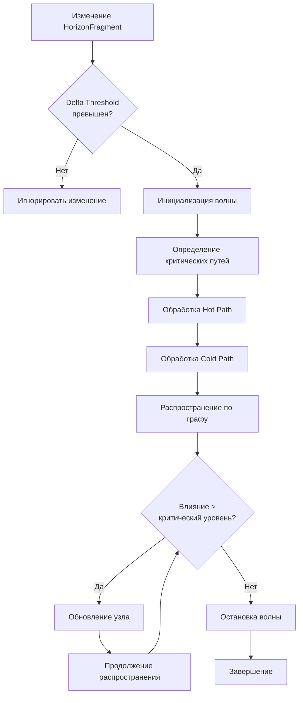

# Алгоритм распространения изменений (Impact Propagation)

## Обзор

Propagation Engine обеспечивает вычислительную устойчивость системы и предотвращает «эффект домино» при обновлении графа зависимостей. Используется многоуровневая система демпфирования для контроля распространения изменений.

## Ключевые принципы

### 1. Порог значимости (Delta Threshold)

Система реагирует не на любое изменение, а только на то, которое превышает установленный порог шума.

**Адаптивные пороги**:
- Для разных типов метрик могут применяться адаптивные пороги
- Пороги основаны на исторической волатильности метрик
- Динамическая корректировка на основе статистики изменений

**Реализация**:
```go
type DeltaThreshold struct {
    MetricName string
    Threshold  float64
    Adaptive   bool
    History    []float64 // Исторические значения для адаптации
}

func (dt *DeltaThreshold) ShouldPropagate(oldValue, newValue float64) bool {
    delta := abs(newValue - oldValue)
    
    if dt.Adaptive {
        threshold := dt.calculateAdaptiveThreshold()
        return delta > threshold
    }
    
    return delta > dt.Threshold
}

func (dt *DeltaThreshold) calculateAdaptiveThreshold() float64 {
    if len(dt.History) < 10 {
        return dt.Threshold // Используем базовый порог
    }
    
    // Вычисляем стандартное отклонение исторических изменений
    volatility := calculateVolatility(dt.History)
    
    // Адаптивный порог = базовый порог * коэффициент волатильности
    return dt.Threshold * (1 + volatility)
}
```

**Примеры порогов**:
- `operational_health`: 0.1 (10% изменение)
- `supply_chain_risk`: 0.05 (5% изменение)
- `regulatory_risk`: 0.15 (15% изменение)

### 2. Затухание волны (Wave Damping)

Влияние события уменьшается по мере его распространения по графу. Вес ребра (DependencyEdge) определяет коэффициент затухания.

**Формула затухания**:
```
influence_at_depth_n = initial_influence * (amplification ^ n) * damping_factor ^ n
```

где:
- `initial_influence` — начальное влияние изменения
- `amplification` — коэффициент усиления из DependencyEdge
- `damping_factor` — коэффициент затухания (обычно 0.8-0.9)
- `n` — глубина распространения (количество пройденных ребер)

**Реализация**:
```go
type WaveDamping struct {
    InitialInfluence float64
    Amplification    float64
    DampingFactor    float64
    MaxDepth         int
}

func (wd *WaveDamping) CalculateInfluence(depth int) float64 {
    if depth > wd.MaxDepth {
        return 0 // Превышена максимальная глубина
    }
    
    amplification := math.Pow(wd.Amplification, float64(depth))
    damping := math.Pow(wd.DampingFactor, float64(depth))
    
    influence := wd.InitialInfluence * amplification * damping
    
    // Остановка волны при падении влияния ниже критического уровня
    if influence < 0.01 {
        return 0
    }
    
    return influence
}
```

**Остановка волны**:
- Если влияние падает ниже критического уровня (например, 0.01), волна останавливается
- Это предотвращает бесконечное распространение незначительных изменений

### 3. Ленивые вычисления (Lazy Evaluation)

Пересчет графа для конечного пользователя (Lens) выполняется по приоритету.

#### Hot Path

**Немедленный пересчет** для:
- Активно используемых Lens (последний доступ < 5 минут)
- Помеченных как критические Lens
- Lens с высоким приоритетом

**Время отклика**: ≤ 5 секунд после критического события

**Реализация**:
```go
func (pe *PropagationEngine) ProcessHotPath(ctx context.Context, fragmentID string) error {
    // Находим все активные Lens, зависящие от этого узла
    lenses := pe.lensRepo.GetActiveLensesByFragment(ctx, fragmentID)
    
    // Фильтруем только Hot Path Lens
    hotLenses := filterHotPathLenses(lenses)
    
    // Параллельный пересчет
    var wg sync.WaitGroup
    for _, lens := range hotLenses {
        wg.Add(1)
        go func(l Lens) {
            defer wg.Done()
            pe.recalculateLens(ctx, l.ID)
        }(lens)
    }
    wg.Wait()
    
    return nil
}

func filterHotPathLenses(lenses []Lens) []Lens {
    var hot []Lens
    now := time.Now()
    
    for _, lens := range lenses {
        // Активно используемые (последний доступ < 5 минут)
        if lens.LastAccessedAt.After(now.Add(-5 * time.Minute)) {
            hot = append(hot, lens)
            continue
        }
        
        // Критические Lens
        if lens.Priority == "critical" {
            hot = append(hot, lens)
            continue
        }
    }
    
    return hot
}
```

#### Cold Path

**Отложенный пересчет** для:
- Неактивных Lens (последний доступ > 1 часа)
- Lens с низким приоритетом
- Lens без активных подписчиков

**Время отклика**: 
- По запросу пользователя: ≤ 1 минуты
- По расписанию: периодический пересчет (например, раз в час)

**Реализация**:
```go
func (pe *PropagationEngine) ProcessColdPath(ctx context.Context, fragmentID string) error {
    // Находим все неактивные Lens
    lenses := pe.lensRepo.GetInactiveLensesByFragment(ctx, fragmentID)
    
    // Добавляем в очередь для отложенного пересчета
    for _, lens := range lenses {
        pe.coldPathQueue.Enqueue(lens.ID)
    }
    
    return nil
}

// Периодический пересчет Cold Path (запускается по расписанию)
func (pe *PropagationEngine) ProcessColdPathQueue(ctx context.Context) error {
    for {
        lensID, ok := pe.coldPathQueue.Dequeue()
        if !ok {
            break
        }
        
        pe.recalculateLens(ctx, lensID)
    }
    
    return nil
}
```

### 4. Топологическая оптимизация

Алгоритм в первую очередь обрабатывает изменения, лежащие на «Критическом Пути» (цепочке узлов с наибольшим совокупным влиянием) для каждой Lens.

**Критический путь**:
- Определяется как путь от измененного узла до Lens с максимальным совокупным влиянием
- Вычисляется через алгоритм поиска кратчайшего пути с учетом весов ребер

**Реализация**:
```go
func (pe *PropagationEngine) FindCriticalPath(ctx context.Context, startFragmentID string, lensID string) ([]string, error) {
    // Используем алгоритм Дейкстры для поиска критического пути
    // Веса ребер = 1 / amplification (меньший вес = большее влияние)
    
    graph := pe.buildGraph(ctx, lensID)
    path := dijkstra.FindPath(graph, startFragmentID, lensID)
    
    return path, nil
}

func (pe *PropagationEngine) ProcessCriticalPathFirst(ctx context.Context, fragmentID string) error {
    // Находим все затронутые Lens
    lenses := pe.lensRepo.GetLensesByFragment(ctx, fragmentID)
    
    for _, lens := range lenses {
        // Находим критический путь для каждой Lens
        criticalPath, err := pe.FindCriticalPath(ctx, fragmentID, lens.ID)
        if err != nil {
            continue
        }
        
        // Обрабатываем узлы на критическом пути в первую очередь
        for _, nodeID := range criticalPath {
            pe.processNode(ctx, nodeID, lens.ID)
        }
    }
    
    return nil
}
```

## Алгоритм распространения

### Основной процесс



### Псевдокод

```go
func (pe *PropagationEngine) PropagateChange(ctx context.Context, fragmentID string, change Change) error {
    // 1. Проверка порога значимости
    if !pe.shouldPropagate(change) {
        return nil // Изменение незначительное, игнорируем
    }
    
    // 2. Инициализация волны
    wave := Wave{
        StartFragmentID: fragmentID,
        InitialInfluence: change.Magnitude,
        VisitedNodes: make(map[string]bool),
    }
    
    // 3. Обработка Hot Path
    hotLenses := pe.getHotPathLenses(ctx, fragmentID)
    for _, lens := range hotLenses {
        pe.recalculateLensImmediate(ctx, lens.ID)
    }
    
    // 4. Распространение по графу
    queue := []WaveNode{{FragmentID: fragmentID, Depth: 0, Influence: change.Magnitude}}
    
    for len(queue) > 0 {
        node := queue[0]
        queue = queue[1:]
        
        // Проверка на максимальную глубину и минимальное влияние
        if node.Depth > pe.maxDepth || node.Influence < pe.minInfluence {
            continue
        }
        
        // Получение зависимых узлов
        dependentNodes := pe.getDependentNodes(ctx, node.FragmentID)
        
        for _, depNode := range dependentNodes {
            // Вычисление влияния с учетом затухания
            edge := pe.getEdge(ctx, node.FragmentID, depNode.ID)
            influence := pe.calculateInfluence(node.Influence, edge, node.Depth)
            
            if influence < pe.minInfluence {
                continue // Влияние слишком мало, останавливаем волну
            }
            
            // Обновление узла
            pe.updateNode(ctx, depNode.ID, influence)
            
            // Добавление в очередь для дальнейшего распространения
            if !wave.VisitedNodes[depNode.ID] {
                queue = append(queue, WaveNode{
                    FragmentID: depNode.ID,
                    Depth: node.Depth + 1,
                    Influence: influence,
                })
                wave.VisitedNodes[depNode.ID] = true
            }
        }
    }
    
    // 5. Обработка Cold Path
    coldLenses := pe.getColdPathLenses(ctx, fragmentID)
    for _, lens := range coldLenses {
        pe.enqueueColdPathRecalculation(ctx, lens.ID)
    }
    
    return nil
}
```

## Интеграция с Realtime системой

### События распространения

**События Pub/Sub**:
- `propagation.started` — начало распространения изменений
- `propagation.node_updated` — обновление узла в графе
- `propagation.lens_recalculated` — пересчет Lens
- `propagation.completed` — завершение распространения

**Публикация событий**:
```go
func (pe *PropagationEngine) publishEvent(ctx context.Context, eventType string, data map[string]interface{}) error {
    return pe.publisher.Publish(ctx, realtime.Event{
        Type: eventType,
        TenantID: data["tenantId"].(string),
        ProjectID: data["projectId"].(string),
        Data: data,
    })
}
```

### WebSocket обновления

**Обновления для фронтенда**:
```json
{
  "type": "propagation.node_updated",
  "fragmentId": "uuid",
  "canonicalPath": "/fac/tsmc/fab-21",
  "influence": 0.75,
  "depth": 2,
  "updatedAt": "2025-12-17T14:30:00Z"
}
```

## Оптимизации производительности

### Батчинг обновлений

Группировка обновлений для уменьшения количества записей в Firestore:

```go
type UpdateBatch struct {
    Updates map[string]*HorizonFragmentUpdate
    MaxSize int
}

func (ub *UpdateBatch) Add(fragmentID string, update *HorizonFragmentUpdate) {
    ub.Updates[fragmentID] = update
    
    if len(ub.Updates) >= ub.MaxSize {
        ub.Flush()
    }
}

func (ub *UpdateBatch) Flush() error {
    // Массовое обновление в Firestore
    return pe.fragmentRepo.BatchUpdate(ctx, ub.Updates)
}
```

### Кэширование графа

Кэширование структуры графа для уменьшения количества запросов к Firestore:

```go
type GraphCache struct {
    cache map[string]*GraphNode
    ttl   time.Duration
}

func (gc *GraphCache) GetNode(ctx context.Context, fragmentID string) (*GraphNode, error) {
    if node, ok := gc.cache[fragmentID]; ok && !node.Expired() {
        return node, nil
    }
    
    // Загрузка из Firestore
    node, err := pe.loadNode(ctx, fragmentID)
    if err != nil {
        return nil, err
    }
    
    gc.cache[fragmentID] = node
    return node, nil
}
```

## Метрики и мониторинг

### Метрики производительности

- **Время распространения**: Среднее время от начала до завершения распространения
- **Глубина распространения**: Средняя глубина распространения изменений
- **Количество обновленных узлов**: Количество узлов, затронутых распространением
- **Hot Path vs Cold Path**: Соотношение немедленных и отложенных пересчетов

### TODO: защита от циклов (важно)

План по защите от циклов и лимитам propagation ведём в **roadmap**: `docs/horizon/implementation/roadmap.md` (секция “Масштабирование и графовая корректность”).

### Логирование

Детальное логирование процесса распространения для отладки и анализа:

```go
pe.logger.Info("propagation started",
    "fragmentId", fragmentID,
    "initialInfluence", change.Magnitude,
    "hotPathLenses", len(hotLenses),
    "coldPathLenses", len(coldLenses),
)
```

## См. также

- [Архитектурный обзор](../architecture/overview.md)
- [Компоненты системы](../architecture/components.md)
- [Scout Workflow](scout-workflow.md)
- [Жизненный цикл](lifecycle.md)

