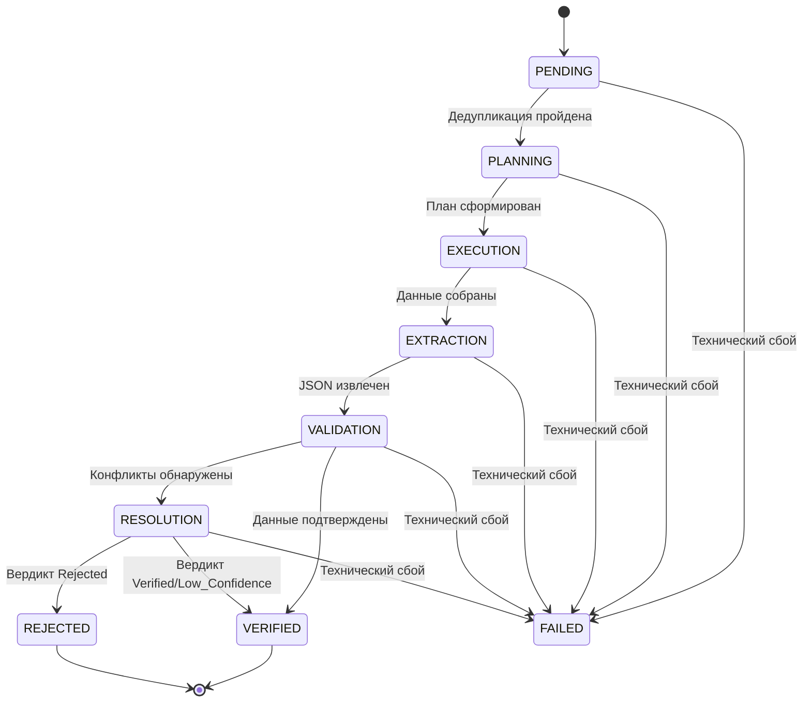

# Рабочий процесс: Сбор и верификация данных агентом Scout

## Обзор

Данный документ описывает автоматизированный рабочий процесс по созданию и верификации информационных единиц (HorizonFragment) в системе. Процесс инициируется запросом от модуля Lens и выполняется полностью автономной системой агентов «Scout» без вмешательства человека.

## Входные данные

Процесс запускается при получении запроса на создание или обновление HorizonFragment:

```json
{
  "requestId": "uuid-v4-string",
  "requestedBy": {
    "tenantId": "string",
    "lensId": "string",
    "projectId": "string"
  },
  "targetNode": {
    "canonicalPath": "/fac/shanghai-port",
    "nodeType": "Infrastructure.Logistics.Seaport"
  },
  "requirements": {
    "maxStaleness": "12h",
    "requiredFields": ["operationalStatus", "throughput.current"],
    "scoutingStrategy": "DeepDive"
  },
  "billingContext": {
    "chargeModel": "Bounty",
    "maxCost": 50.00
  }
}
```

### Параметры запроса

- **requestId**: Уникальный идентификатор запроса
- **requestedBy**: Контекст инициатора (tenantId, lensId, projectId)
- **targetNode**: Целевой узел (canonicalPath, nodeType)
- **requirements**: Требования к данным (maxStaleness, requiredFields, scoutingStrategy)
- **billingContext**: Контекст биллинга (chargeModel: "Bounty" или "Access", maxCost)

### Стратегии разведки

- **Snapshot**: Быстрый снимок текущего состояния (≤ 1 минуты)
- **DeepDive**: Глубокое исследование с множественными источниками (≤ 30 минут)

## Состояния процесса

Процесс представляет собой конечный автомат, где каждый запрос (ScoutingJob) проходит через определенные состояния:

| Состояние | Описание | Ответственный компонент |
|-----------|----------|-------------------------|
| PENDING | Запрос получен, поставлен в очередь и ожидает дедупликации | Request Queue Manager |
| PLANNING | Система определяет тип задачи, выбирает релевантные источники данных | Scout Planner Agent |
| EXECUTION | Агенты выполняют запросы к внешним источникам, скачивают и очищают контент | Execution Agent |
| EXTRACTION | LLM-агент (The Scout) извлекает структурированные данные из сырого контента | Extraction Agent (Scout) |
| VALIDATION | Происходит состязательная проверка извлеченных данных. Данные и исходники передаются агенту-критику | Validation Agent (Critic) |
| RESOLUTION | В случае расхождений между Scout и Critic, агент-арбитр выносит финальное решение | Resolver Agent (Judge) |
| VERIFIED | Данные успешно прошли проверку и готовы к публикации | Graph Publisher Service |
| REJECTED | Данные не прошли проверку на этапе VALIDATION или RESOLUTION | Resolver Agent (Judge) |
| FAILED | Технический сбой на любом из этапов | Workflow Engine |

## Диаграмма состояний



## Правила перехода между состояниями

### PENDING → PLANNING

**Триггер**: 
- Запрос прошел дедупликацию (нет активных запросов на тот же canonicalPath)
- Доступны вычислительные ресурсы

**Действие**: 
- Создается экземпляр ScoutingJob с уникальным ID
- ScoutingJob привязан к Project через `projectId`
- Запускается Scout Planner Agent
- Planner получает Sources проекта для использования

**Дедупликация**:
```go
// Проверка активных запросов
activeJobs := r.scoutRepo.GetActiveJobsByPath(ctx, tenantID, canonicalPath)
if len(activeJobs) > 0 {
    return ErrDuplicateRequest
}
```

### PLANNING → EXECUTION

**Триггер**: 
- План сбора данных успешно сформирован и валидирован

**Действие**: 
- Запускаются подзадачи на выполнение запросов к каждому источнику из плана
- Параллельное выполнение запросов к источникам

**Планирование источников**:
```go
type SourcePlan struct {
    DataSourceIDs []string `json:"dataSourceIds"` // DataSource IDs из проекта
    Strategy      string   `json:"strategy"`      // "Snapshot" или "DeepDive"
    Sources       []DataSource `json:"sources"`   // Полные объекты DataSource
}

// Scout Planner использует Sources проекта
func (p *ScoutPlanner) PlanSources(ctx context.Context, job *ScoutingJob) (*SourcePlan, error) {
    // 1. Получаем Sources проекта
    projectSources, err := p.dataSourcesRepo.ListByProject(ctx, job.TenantID, job.ProjectID)
    if err != nil {
        return nil, fmt.Errorf("failed to list project sources: %w", err)
    }
    
    // 2. Получаем глобальные Sources (web, rss, telegram_channel)
    globalSources, err := p.dataSourcesRepo.ListGlobal(ctx)
    if err == nil {
        projectSources = append(projectSources, globalSources...)
    }
    
    // 3. Фильтруем релевантные Sources для целевого узла
    relevantSources := p.filterRelevantSources(projectSources, job.TargetCanonicalPath)
    
    return &SourcePlan{
        DataSourceIDs: extractIDs(relevantSources),
        Strategy:      job.ScoutingStrategy,
        Sources:       relevantSources,
    }, nil
}
```

### EXECUTION → EXTRACTION

**Триггер**: 
- Все необходимые сырые данные от источников успешно собраны

**Действие**: 
- Данные агрегируются и передаются агенту The Scout для извлечения фактов
- Использование constrained decoding для генерации JSON

**Сбор данных**:
```go
// Параллельный сбор из DataSource
var wg sync.WaitGroup
results := make([]SourceContent, len(plan.Sources))

for i, dataSource := range plan.Sources {
    wg.Add(1)
    go func(idx int, ds *models.DataSource) {
        defer wg.Done()
        
        // Используем существующую инфраструктуру обработки Sources
        content, documentID, err := executor.ExecuteDataSource(ctx, ds)
        if err == nil {
            results[idx] = SourceContent{
                DataSourceID: ds.ID,
                DocumentID:   documentID,
                Content:      content,
                Hash:         computeHash(content),
                Kind:         ds.Kind,
            }
        }
    }(i, dataSource)
}
wg.Wait()
```

### EXTRACTION → VALIDATION

**Триггер**: 
- Агент The Scout успешно вернул JSON-объект, соответствующий схеме

**Действие**: 
- Извлеченный JSON и исходные тексты передаются агенту The Critic
- Проверка соответствия схеме через Pydantic валидацию

**Извлечение данных**:
```go
extractedData, err := scoutAgent.Extract(ctx, ScoutRequest{
    Sources: aggregatedContent,
    Schema: horizonFragmentSchema,
    Constraints: Constraints{
        JSONMode: true,
        StrictSchema: true,
    },
})
if err != nil {
    return err // Переход в FAILED
}

// Валидация схемы
if err := validateSchema(extractedData, horizonFragmentSchema); err != nil {
    // Повторная попытка с уточнением
    return retryWithClarification(err)
}
```

### VALIDATION → RESOLUTION

**Триггер**: 
- Агент The Critic обнаружил несоответствия между извлеченным JSON и исходными данными

**Действие**: 
- Конфликтные данные, аргументы Scout и Critic передаются агенту The Resolver
- Формирование полного контекста для принятия решения

**Валидация**:
```go
validationResult, err := criticAgent.Validate(ctx, ValidationRequest{
    ExtractedData: extractedData,
    SourceContent: aggregatedContent,
    Schema: horizonFragmentSchema,
})

if validationResult.HasConflicts {
    // Переход в RESOLUTION
    return transitionToResolution(validationResult)
}
```

### VALIDATION → VERIFIED

**Триггер**: 
- Агент The Critic подтвердил полное соответствие данных источникам

**Действие**: 
- Процесс переходит к финальной публикации, минуя RESOLUTION
- Создание Frame с статусом ACCEPTED

### RESOLUTION → VERIFIED

**Триггер**: 
- Агент The Resolver вынес вердикт Verified или Low_Confidence

**Действие**: 
- Данные с соответствующей меткой доверия передаются на публикацию
- Создание Frame с validationResult из Resolver

**Разрешение конфликтов**:
```go
resolution, err := resolverAgent.Resolve(ctx, ResolutionRequest{
    ScoutData: extractedData,
    CriticArguments: validationResult.Conflicts,
    SourceContent: aggregatedContent,
})

switch resolution.Verdict {
case "Verified":
    return transitionToVerified(resolution)
case "Low_Confidence":
    return transitionToVerified(resolution) // С меткой низкой уверенности
case "Rejected":
    return transitionToRejected(resolution)
}
```

### RESOLUTION → REJECTED

**Триггер**: 
- Агент The Resolver вынес вердикт Rejected

**Действие**: 
- ScoutingJob завершается с отрицательным результатом
- Владельцу Lens отправляется уведомление
- Frame создается со статусом REJECTED для аудита

### VERIFIED → (Конечное состояние)

**Триггер**: 
- HorizonFragment успешно записан или обновлен в графовой базе данных

**Действие**: 
- Инициируется событие NodePublished, которое запускает алгоритм пересчета зависимых Lens
- Процедура биллинга выполняется на основе billingContext изначального запроса
- Watchdog конфигурация обновляется для активного узла

## Интеграция с AgentJob системой

### Маппинг состояний

ScoutingJob использует существующую систему AgentJob для отслеживания прогресса:

```go
type ScoutingJob struct {
    AgentJob // Встраивание существующей структуры
    TargetCanonicalPath string
    ScoutingStrategy string
    BillingContext BillingContext
    CurrentState ScoutingState
}
```

### Использование AgentStep

Каждое состояние ScoutingJob соответствует одному или нескольким AgentStep:

```go
steps := []AgentStep{
    {
        Capability: "scout_planning",
        Status: AgentStepStatusCompleted,
        Output: map[string]interface{}{
            "plan": sourcePlan,
        },
    },
    {
        Capability: "scout_extraction",
        Status: AgentStepStatusRunning,
        Input: map[string]interface{}{
            "sources": aggregatedContent,
        },
    },
}
```

## Метрики качества

Качество выполнения процесса и результирующих данных оценивается по следующим метрикам:

### Verification Score

Числовая оценка (0.0 до 1.0), присвоенная агентом The Resolver, отражающая уверенность системы в достоверности данных.

### Data Freshness

Разница во времени между моментом публикации данных и временем события в источнике:
```
freshness = timestamp_event - timestamp_published
```

### Source Reliability Score

Средневзвешенное значение рейтинга надежности источников, использованных для получения данных.

### Schema Completeness

Процент обязательных полей (requiredFields), которые удалось успешно извлечь и верифицировать.

### End-to-End Latency

Общее время выполнения ScoutingJob от состояния PENDING до VERIFIED:
- Snapshot: ≤ 1 минуты
- DeepDive: ≤ 30 минут (асинхронная операция)

## Обработка ошибок

### Технические сбои

**Недоступность источников**:
- Повторные попытки с экспоненциальной задержкой
- Использование альтернативных источников из плана
- Переход в FAILED после исчерпания попыток

**Ошибки API LLM**:
- Повторные попытки с backoff
- Переключение на альтернативные модели
- Переход в FAILED при критических ошибках

**Ошибки валидации схемы**:
- Автоматический повтор запроса с уточнением схемы
- Использование более детальных промптов
- Переход в FAILED после нескольких неудачных попыток

### Логические ошибки

**Несоответствия данных**:
- Переход в RESOLUTION для разрешения конфликтов
- Использование Resolver Agent для принятия решения
- Создание Frame с меткой Low_Confidence при неуверенности

## Суточный лимитер стоимости (MVP guardrails)

На этапе MVP мы намеренно **ограничиваем каскадные эффекты по стоимости**, чтобы отладка и развитие системы не приводили к неуправляемым расходам.

### Принцип

- **Все лимиты — суточные (UTC day)**.
- Ограничение делается **глубиной, а не шириной**:
  - если лимит превышен — система **не углубляет рекурсию** (не создаёт новые child-jobs глубже),
  - и может **пропустить дорогой этап Research** (grounding / web-enrichment).

### Что именно ограничивается

- **Research stage**: если превышены лимиты — `ResearchAgent` не вызывается, job продолжает обработку без enrichment.
- **Recursive scouting**: при превышении лимитов система **режет `maxRecursionDepth` до текущей глубины**, т.е. каскад прекращается по глубине.

### Основа расчёта (USD + token caps)

Лимитер использует две независимые «сетки безопасности»:

- **USD budget**: фактическая стоимость вызовов LLM агрегируется в Firestore ledger:
  - per-lens per-day (UTC)
  - per-cascade per-day (UTC), где cascade идентифицируется `cascadeRootJobId`
- **Token caps (fallback)**: если по каким-то причинам USD-атрибуция/стоимость недоступна или некорректна, применяется ограничение по токенам.

**Важно**: если модель вернула `0` использованных токенов, токены считаются приближённо как `len(text)/4`.

### Дефолтные лимиты

- **Cascade/day**: `$0.50` (UTC)
- **Lens/day**: `$4.00` (UTC)
- **Token caps (output tokens)**: по умолчанию выводятся из USD-лимитов по консервативной цене \( \$3 / 1M output tokens \) (в духе `gemini-3-flash-preview`), но могут быть переопределены.

### Конфигурация через env

- `HORIZON_BUDGETS_ENABLED` (default: `1`)
- `HORIZON_CASCADE_DAILY_MAX_USD` (default: `0.50`)
- `HORIZON_LENS_DAILY_MAX_USD` (default: `4.00`)
- `HORIZON_CASCADE_DAILY_MAX_OUTPUT_TOKENS` (default: derived)
- `HORIZON_LENS_DAILY_MAX_OUTPUT_TOKENS` (default: derived)

### Как это связано с телеметрией

Вызовы LLM пишут usage/telemetry метрики, а лимитер использует ledger-агрегации, которые атрибутируют расходы к:

- `lensId` (per-lens/day)
- `cascadeRootJobId` (per-cascade/day)

## Использование таксономии

Scout Agent должен использовать базовую таксономию (Core Taxonomy v1.0) при извлечении данных:

1. **Классификация сущности**:
   - Определение `entityPath` согласно Entity Types Taxonomy (`/Organization/*`, `/Infrastructure/*`, `/Resource/*`, `/Person/*`, `/Geo/*`)
   - Определение `sectorPath` согласно Industry & Sector Taxonomy (`/Energy/*`, `/Technology/*`, `/Materials/*`, и т.д.)

2. **Извлечение Location**:
   - Для географических сущностей: использование ISO стандартов
   - ISO 3166-1 alpha-2 для стран (например, "US", "KZ", "RU")
   - ISO 3166-2 для административных делений (например, "US-CA", "KZ-75", "RU-MOW")
   - ISO 6709 для координат (формат: `±DD.DDDD±DDD.DDDD/`)

3. **Извлечение метрик**:
   - Использование стандартизированных метрик согласно таксономии
   - Соблюдение диапазонов (Magnitude: 0.0-1.0, Directional: -1.0-1.0)
   - Каждая метрика должна содержать:
     - `value`: числовое значение в нормализованном диапазоне
     - `confidence`: уверенность в значении (0.0-1.0)
     - `observedAt`: время наблюдения
     - `unit`: единица измерения (если применимо)
     - `errorMargin`: интервал ошибки (если доступен)
     - `provenance`: источник данных

4. **Дополнительные метрики**:
   - Система поддерживает произвольные метрики с описаниями и типами
   - При добавлении новой метрики необходимо указать type (magnitude/directional), range, unit, description, category

5. **Валидация**:
   - Проверка соответствия путей допустимым значениям
   - Проверка диапазонов метрик
   - Проверка ISO стандартов для Location
   - Проверка структуры метрик (наличие обязательных полей)

Подробнее см. [Базовая таксономия](../architecture/taxonomy.md).

## См. также

- [Архитектурный обзор](../architecture/overview.md)
- [Компоненты системы](../architecture/components.md)
- [Базовая таксономия](../architecture/taxonomy.md)
- [Propagation Workflow](propagation-workflow.md)

